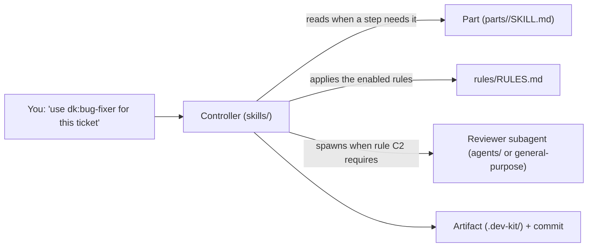
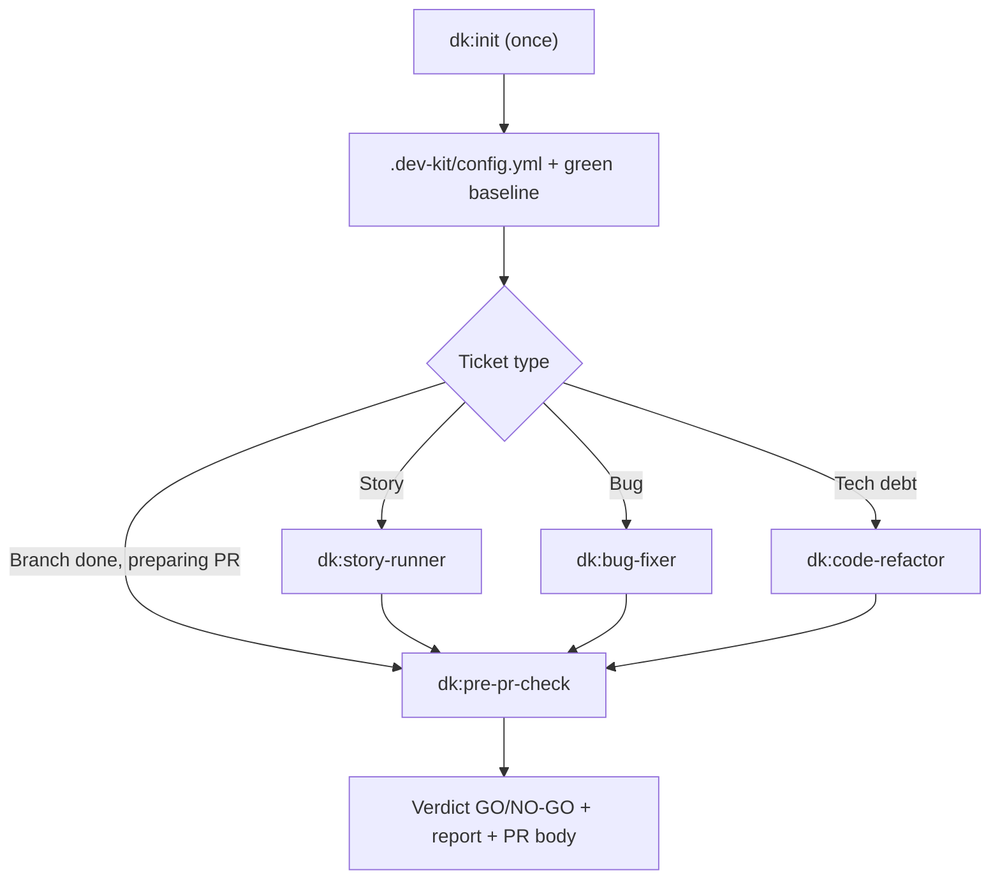

English | [Tiếng Việt](../vi/02-architecture.md)

# 2. Architecture

## 2.1 Directory layout

```text
dev-kit/
├── .claude-plugin/
│   ├── plugin.json         # plugin name "dk", version (Copilot CLI also reads this file)
│   └── marketplace.json    # for installing via /plugin marketplace
├── .codex-plugin/plugin.json        # Codex manifest ("skills": "./skills/")
├── .agents/plugins/marketplace.json # marketplace "dev-kit" for codex plugin marketplace add
├── .cursor-plugin/plugin.json       # Cursor manifest (not verified)
├── .antigravity-plugin/plugin.json  # Antigravity (agy) manifest
├── .version-bump.json      # manifests that must share one version (scripts/bump_version.py)
├── skills/                 # 5 registered skills: init + 4 controllers
│   ├── init/ story-runner/ bug-fixer/ code-refactor/ pre-pr-check/
├── parts/                  # 16 sub-skills copied from upstream: NOT registered as skills
├── agents/                 # review subagent personas: security-auditor, test-engineer
├── harness/                # per-CLI tool notes (Codex, Copilot, agy, OpenCode, Cursor, omp)
├── rules/RULES.md          # the rule set: status + evidence
├── templates/              # spec.md, report.md, config.yml, dogfood-log.md
├── scripts/                # check_parts.py, check_report.py, bump_version.py, install-graph-tools.sh
├── UPSTREAM.md  LICENSES/  CHANGELOG.md  README.md  docs/
```

**Many CLIs, one set of skills** (the Superpowers approach): controllers are written in Claude Code vocabulary. The **Harness** paragraph at the top of each controller tells the agent how to find the kit directory when the CLI does not substitute `${CLAUDE_PLUGIN_ROOT}`, then points to `harness/<cli>.md`. That file maps `dk:<skill>`, subagents and the two review agents to the CLI's own tools. Controller content is not split per CLI.

## 2.2 Three layers: controller, part, rule



### Controller

- A real skill, with `name` and `description` in the frontmatter. Claude Code loads only the description when a session opens.
- Very thin: about 20 lines per file, made of 4 shared blocks (Parts, Rules, Commands, Report) and 4–5 steps of its own.
- Works directly in the main session by default. It reads a part or spawns a subagent only when a step or a rule asks for it.

### Part

- The `SKILL.md` of the original set, copied as a whole directory (including side files such as scripts and prompt templates), with names and references adjusted to match.
- **Not registered as a skill.** The lab showed that if you register a part and then hide it with `disable-model-invocation`, even the controller cannot call it through the Skill tool. Kept under `parts/`, a part costs no context when a session opens, and the controller reads it by path when needed.
- Path: `../../parts/<name>/SKILL.md`, relative to the controller skill's root directory. Paths inside a part are relative to that part's directory.

### Rule

- Lives in `rules/RULES.md`. Each rule has an ID, a statement, a status (**on**/**off**) and evidence.
- Controllers apply only the **on** rules. Details in [04](04-rules.md).

## 2.3 Part map: who uses which part

| Part | Source | Used by |
|---|---|---|
| `grilling` | Matt | story-runner (ambiguous ticket) |
| `domain-modeling` | Matt | story-runner (new terminology) |
| `codebase-design` | Matt | code-refactor (unclear boundaries) |
| `code-review` | Matt | pre-pr-check (every review level) |
| `pr` | Matt | pre-pr-check (PR body) |
| `diagnosing-bugs` | Matt | bug-fixer (performance bugs, hard bugs) |
| `systematic-debugging` | Superpowers | bug-fixer (hard bugs) |
| `test-driven-development` | Superpowers | referenced by `systematic-debugging` |
| `verification-before-completion` | Superpowers | referenced by `systematic-debugging` |
| `receiving-code-review` | Superpowers | pre-pr-check (fixing blockers) |
| `writing-plans` | Superpowers | story-runner, code-refactor (large work) |
| `using-git-worktrees` | Superpowers | large work; referenced by SDD and writing-plans |
| `subagent-driven-development` | Superpowers | large work |
| `requesting-code-review` | Superpowers | SDD needs the `code-reviewer.md` file in it |
| `finishing-a-development-branch` | Superpowers | large work (merge the branch back, clean up the worktree) |
| `constraint-driven-development` | agent-skills | init (creates `CONSTRAINTS.md`, optional) |

The persona agents `dk:security-auditor` and `dk:test-engineer` (agent-skills) are used only when pre-pr-check picks the 4-reviewer level.

## 2.4 Artifacts: `.dev-kit/`

| Path | Written by | Content |
|---|---|---|
| `.dev-kit/config.yml` | `dk:init` | Test/lint/build commands, base branch, tracker, graph tools |
| `.dev-kit/init-report.md` | `dk:init` | What exists, what was created, what is missing, commands run and their results |
| `.dev-kit/baseline.md` | `dk:init` (when the baseline is red and you accept it) | List of tests that already fail; controllers compare against this list (rule B1) |
| `.dev-kit/specs/<feature>.md` | story-runner | Per `templates/spec.md`: goal, rules, interface, acceptance criteria, out of scope, **Decisions** |
| `.dev-kit/plans/` | story-runner/code-refactor (large work) | Plan per `writing-plans` |
| `.dev-kit/reports/<name>.md` | every controller | Report per `templates/report.md`: what changed, why, tests, commands run, review table, open questions |
| `.dev-kit/sdd/<plan>/` | subagent-driven development (large work) | Ledger, per-task briefs, review packets. Has its own `.gitignore` |
| `.dev-kit/reports/pr-body.md` | pre-pr-check | PR body: Summary / Evidence / Merge Danger |

**Deliberate exceptions** (rule O1): these files are project documents, not dev-kit's, so they live at the repo root.
- `GLOSSARY.md` and `docs/adr/`: written by the `domain-modeling` part.
- `CONSTRAINTS.md`: written by the `constraint-driven-development` part.

dev-kit does not edit `CLAUDE.md`/`AGENTS.md` without asking.

Which parts of `.dev-kit/` to commit is each repo's decision: `dk:init` asks.

## 2.5 Configuration: `.dev-kit/config.yml`

Illustrative example (the schema is not final):

```yaml
base_branch: main
commands:
  check: make check   # one command that runs every check; controllers prefer it
  test: npm test
  lint: npm run lint
  build: npm run build
tracker: none        # not used in 0.6.0
graph:
  codegraph: false   # true when .codegraph/ exists (rule G1)
  crg: false         # true when .code-review-graph/ exists (rule G1)
```

Source template: `templates/config.yml`. If the file exists, controllers use `commands.check` (or `commands.test` if there is no check) and `base_branch`. If there is no file, controllers use `make check` (if the repo has it) or the test command in the repo's docs, and treat the base branch as `main`.

## 2.6 Graph tools (rule G1, `rules/graph-playbook.md`)

| Tool | Built with | Where controllers use it |
|---|---|---|
| codegraph | `codegraph init` (via `dk:init`) → `.codegraph/` | Every controller: `codegraph sync`, then `explore`/`callers`/`impact` to find code; `git diff --name-only \| codegraph affected --stdin -q` to pick which tests to run first. bug-fixer traces from symptom to code; code-refactor records the blast radius in the report |
| code-review-graph | `code-review-graph build` (via `dk:init`, **not** `install`) → `.code-review-graph/` | `pre-pr-check`: one `update` + `detect-changes --brief --base <base>`, then a summary (risk, test gaps, functions without tests) handed to every reviewer |

- **CLI only:** no MCP server, no hooks, no instruction files written, so no added baseline context.
- **Playbook:** the commands are detailed in [`rules/graph-playbook.md`](../../rules/graph-playbook.md): §1 update, §2 find code, §3 blast radius, §4 existing tests, §5 refactor, §6 module map, §7 review. The 4 controllers and 8 parts each have one line pointing to the right section.
- **Repo without an index:** controllers skip this step.
- **Measured result:** neutral, see [06](06-evidence.md).

## 2.7 Exchange formats between steps

| Exchange | Shared format |
|---|---|
| Ticket → spec | `templates/spec.md` (has a Decisions section) |
| Spec → plan → SDD | Plan per the `writing-plans` part, stored in `.dev-kit/plans/`; SDD reads the plan and writes its ledger to `.dev-kit/sdd/` |
| Spec → reviewer | The controller passes the path `.dev-kit/specs/…` (or the issue text); the `code-review` part looks for the spec in `.dev-kit/specs/` first |
| Reviewer → controller | Each finding: `file:line | blocker/major/minor | reason` (rule S1). Every reviewer, including the 2 persona agents and the reviewers inside SDD, uses the same scale |
| Controller → reader | `templates/report.md`; PR body per the `pr` part |

## 2.8 Overall flow


