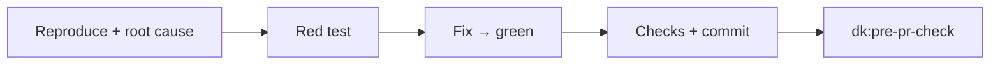
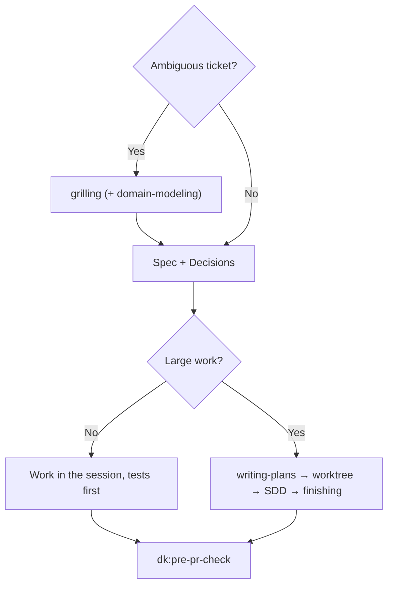

English | [Tiếng Việt](../vi/03-skills.md) | [简体中文](../zh-CN/03-skills.md) | [日本語](../ja/03-skills.md)

# 3. Skills

The four controllers share the same behavior blocks before their own steps:

| Block | Meaning |
|---|---|
| **Parts** | Read a part only when a step mentions it; parts are not skills |
| **Rules** | Apply the rules that are on in `rules/RULES.md`: F1, F2, C1, C2, G1, S1, O1 ([04](04-rules.md)) |
| **Graph** | If the repo has a codegraph/CRG index, use it per rule G1; if not, skip |
| **Commands** | Take the check commands and base branch from `.dev-kit/config.yml` if it exists; otherwise use `make check` or the repo's test command, and `main` |
| **Outputs** | Everything is written into `.dev-kit/` (rule O1); finish with a report per `templates/report.md`; severity uses the blocker/major/minor scale (rule S1) |

The examples below are **illustrations, not run** on your repo. Real examples are in the lab, see [06](06-evidence.md).

---

## 3.1 `dk:init`

**Use when:** using dev-kit for the first time on a machine or a repo; to re-check the setup; or to re-run one part: `dk:init index` (for example in a new worktree), `dk:init baseline`, `dk:init standards [rules|review]`.

**Principles:**
- **Probe first, then ask one question at a time, in a fixed order.** Each question shows what the agent found, a default and short options; it waits for your answer before the next one. "default" and "skip" always work. It never asks what the code already answers.
- A re-run only checks and fills in what is missing; it does not overwrite existing files.
- Installing anything or changing anything outside the repo requires asking first.
- `.dev-kit/` is personal: nothing it creates is committed, and it never edits a tracked file such as `.gitignore`.
- It contains no controller logic.

**Steps and questions, in order:**
1. **Graph tools:** checked with `scripts/install-graph-tools.sh --check`. *Question only if one is missing:* install it? If you decline, it continues with "G1 off". It never runs `codegraph install` or `code-review-graph install` (they register MCP, hooks and instruction files).
2. **Personal settings:** reads `~/.dev-kit/config.yml` if an earlier repo saved a team standards folder there.
3. **Probe, no questions:** commands, base branch, stack, what the linters already enforce, files already tracked under `.dev-kit/`, the project's own `GLOSSARY.md`, `docs/adr/`, `CONSTRAINTS.md`.
4. *Question:* **commands and base branch** (confirm or correct). Then it creates `.dev-kit/` with a `.gitignore` containing `*` and writes `config.yml`.
5. *Question:* **graph indexes** (default yes; the expected size for a large repo, roughly 150 MB and 600 MB per ~3,000 files). Index folders that still show in `git status` (codegraph keeps its own `.gitignore` visible) go to `.git/info/exclude`.
6. **Baseline:** runs tests and build once. *Question only if red:* **stop** (fix first) or **accept as a known baseline**, written to `.dev-kit/baseline.md`; from then on a run fails only when a test **outside** that list fails (rule B1). If the tests **could not run** (package restore, authentication, a missing service), it says so and asks whether to stop or continue with the baseline marked `not-measured` in `config.yml`; rerun `dk:init baseline` once the environment works.
7. **Standards in two passes** (below).
8. *Question:* **`CONSTRAINTS.md`** (optional, default no) → `.dev-kit/CONSTRAINTS.md`. Skipped when the project has its own. The question explains what the file adds for your repo (below).
9. **Report** `.dev-kit/init-report.md`, and a check that `git status` is unchanged.

**Standards in two passes** (design: [09](09-init-and-standards.md), section 9.6). Rules are written only for what the agent cannot know or has been seen to get wrong; never naming or style.
- **Probe first:** what the linter and compiler cover; the structure (layers, how data is reached, modules, exposed contracts, config, permission keys), found with the graph; in-house libraries (internal packages, how many files use them against framework controls, what recent files use, their component list).
- **One group per question, like a brainstorm:** the group's list in detail (every item: what it asks, why, where this repo hits it, with counts from commands the agent ran; kit files marked `validated` or `experimental`), then a **Recommended** line with one reason per part. "default" accepts Recommended exactly as shown, "skip" takes nothing, or answer item by item, with project or team scope for repo items. A claim like "X replaces Y" without usage evidence becomes a choice.
- **Pass 1, rules for writing code** (`## Design`/`## Implement`, used by story-runner, bug-fixer, code-refactor):
  1. **Architecture:** the probe is the standard list (the kit has no architecture file under principle 0); what neighbouring code already shows is not recommended;
  2. one group per kit file with Implement items that fit the repo: `coding/review-basics`, `testing/basics`, `security/web`, `ui/forms-and-actions`;
  3. one group per in-house library (is the old version still allowed, which framework controls stay allowed);
  4. **your own conventions, in a loop:** the other probe suggestions plus free text, then "Any other convention?" after every answer until you say no.

  Then the pass-1 rules are read back for your confirmation and written.
- **Pass 2, review checklist** (`## Review`/`## Do not flag`/`## Severity`, used by pre-pr-check): rules kept in pass 1 are not asked again, each is checked at its severity, and `review/finding-quality` is always on.
  1. **Severity** of the kept rules (kit items keep theirs; the agent proposes one per repo rule);
  2. **review-only checks** ("when the diff touches X, check Y"), never a restatement of a pass-1 rule;
  3. **Do not flag:** what the linter, compiler and CI enforce, the kit's lines, repo noise;
  4. **your own checks, in a loop**, as in pass 1.

  Then the checklist is read back and written into the same topic files.
- No question limit: the loops end when you say no. Headless runs take each Recommended line and end the loops. Redo one pass with `dk:init standards rules` or `dk:init standards review`.

**Kit standards** (all `experimental` until measured on new bugs): `review/finding-quality` (always on), `coding/review-basics`, `security/web` (OWASP Top 10:2025, ASVS 5.0), `testing/basics`, `ui/forms-and-actions` (WCAG 2.2).

**`CONSTRAINTS.md` versus standards.** Both are optional parts of your setup, but they answer different questions:

| | Standards (`.dev-kit/standards/`) | `CONSTRAINTS.md` |
|---|---|---|
| Answers | How is code written in this repo? | How good must a change be before it ships? |
| Content | Rules the agent cannot guess, by topic, with IDs (for example "use the in-house controls") | Numbers with the command that checks each (for example "zero type errors: `tsc --noEmit`", "changed lines ≥ 80% covered"), a floor that always applies (no new `@ts-ignore`, stubs, skipped tests, secrets), agreed exceptions |
| Used when | Planning, coding and review | `dk:pre-pr-check` step 1: a change that breaks it is a blocker |
| Purpose | Code that fits the repo | The agent cannot quietly lower the bar to get green |

Without `CONSTRAINTS.md`, `dk:pre-pr-check` still flags new skips, suppressions, deleted asserts and weakened thresholds in the diff. The file adds numeric gates for dimensions the repo does not check yet (coverage, type errors, security scans, performance or accessibility budgets). It costs up to four more questions (which dimensions, block or warn, target numbers or "measure today and hold", slowest acceptable check) and possibly a tool to install, always asked first. Its benefit has not been measured in the dev-kit lab, which is why the default is no. The interview comes from the `constraint-driven-development` part (agent-skills).

**Outputs:** `config.yml`, the `.dev-kit/` directory, the standards you chose, the init report, optionally `.dev-kit/CONSTRAINTS.md` and the graph indexes. Nothing to commit.

---

## 3.2 `dk:bug-fixer`

**Use when:** a bug ticket, including performance bugs (something got slower after a change).

**Steps:**
1. **Reproduce and find the root cause.** For a hard bug or a performance bug, read the `systematic-debugging` or `diagnosing-bugs` part and follow it.
2. **Write a regression test** that fails for the right reason → fix at the root cause → test goes green.
3. **Run the check commands.** Commit; the message states the root cause.
4. **Run `dk:pre-pr-check`.**

**Outputs:** a fix commit with its test, a report, the pre-pr-check result.

**Not included:** a separate reproduction subagent or fix subagent (an older version had them; the lab showed they only cost more), and no worktree.

**Example (illustration):** ticket "An order with 2 promotions has its goods total drop to 0".
- The agent finds code that sums the percentages of all promotions, while the rule is to take only the highest promotion.
- It writes a test with two promotions, 60% and 50% (red), changes the code to `max`, runs the checks, and commits "fix: promotions must not stack".
- pre-pr-check: the diff is small, so it does a self-review and writes the report.

---

## 3.3 `dk:story-runner`

**Use when:** a feature/story ticket.

**Steps:**
1. **Clarify.** If the ticket is ambiguous, read the `grilling` part and ask you one question at a time. If there are new business terms, also read the `domain-modeling` part. Only when nobody can answer (headless run) does it pick a reasonable option itself and mark it as an assumption.
2. **Write the spec** `.dev-kit/specs/<feature>.md` per `templates/spec.md`: goal, rules, interface, acceptance criteria, out of scope, and a **Decisions** section (question, answer, who decided or "assumption").
3. **Follow rule C1:**
   - **Small work:** do it right in the session, tests first, one commit per behavior.
   - **Large work** (more than 3 tasks or several modules): use the parts in order: `writing-plans` → `using-git-worktrees` → `subagent-driven-development` → `finishing-a-development-branch` (merge back into the branch you are working on; no push/PR).
4. **Run `dk:pre-pr-check`.**

**Example (illustration):** ticket "A customer enters a discount code at checkout".
- grilling asks: one code or several per order, deducted before or after tax, and what to show for an invalid code.
- The spec records the answers in Decisions.
- It is small work (1 module), so it is done in the session: a test per rule, a commit per behavior; at the end it runs pre-pr-check.

---

## 3.4 `dk:code-refactor`

**Use when:** a tech-debt ticket: split, merge or move modules **without changing behavior**.

**Steps:**
1. **Fix the new interface.** If the boundaries are unclear, read the `codebase-design` part.
2. **Write characterization tests first**, at the public interface, pinning current behavior for every input. Pin behavior that looks like a bug too: record it in the report as "suspect bug" and **do not fix** it during the refactor.
3. **Follow rule C1:** for small work, move in small steps inside the session, check after each step, commit each step. For large work, use the SDD parts as story-runner does.
4. **Run `dk:pre-pr-check`.** The review checks "no behavior change" and the interface you fixed.

**Why pin even behavior that looks like a bug:** in the lab, a refactor ticket is graded by comparing behavior before and after on 300 random inputs. If you "fix a bug while you are there" during the refactor, behavior changes, and the reviewer cannot tell which part is the refactor and which is the bug fix.

---

## 3.5 `dk:pre-pr-check`

**Use when:** the branch is done and a PR is about to be opened. The other three controllers call it at the end on their own; you can also call it directly for a branch written by a person.

**Report-only mode:** if the request says "do not change code", it edits no file and skips step 4.

**Steps:**
1. **Run the check commands right now** and keep the output as Evidence. Read `git diff <base branch>...HEAD` for signs of lowered standards: new tests skipped, `noqa`/`ts-ignore` added, asserts removed, thresholds lowered.
2. **Pick the review level per rule C2:**

   | Level | When | What it does |
   |---|---|---|
   | Self-review | Diff ≤ 2 files and < 50 lines (measured with `git diff --shortstat`) | Read the `code-review` part and apply its two axes yourself; spawn no subagent |
   | 1 reviewer | Everything else | 1 general-purpose subagent that reads the `code-review` part |
   | 4 reviewers | You ask for it, or the diff touches auth/permissions, secrets, personal data, migrations, config/env | In parallel: 2 `code-review` reviewers (one axis each), `dk:security-auditor`, `dk:test-engineer` |

   Each reviewer receives the diff range and the spec/issue text, and returns `file:line | blocker/major/minor | reason`.
3. **Merge the results** into one table on the blocker/major/minor scale. If any blocker is still open, `Verdict: NO-GO`; otherwise `GO`.
4. **If there are blockers:** read the `receiving-code-review` part, fix with evidence (or push back with a reason), and go back to step 1. At most 2 rounds.
5. **Report with the findings table.** Unless in report-only mode, write `.dev-kit/reports/pr-body.md` per the `pr` part (Summary / Evidence / Merge Danger), with Evidence being the output of step 1.

**Example (illustration):** a "partial refund" branch touches permissions and personal data, so it runs 4 reviewers. The result is NO-GO with these blockers:
- a non-staff role can still issue refunds;
- a refund can be repeated many times;
- rounding goes up instead of down;
- the customer's email leaks into the audit log.

It comes with a file:line table and a drafted PR body.

---

## 3.6 The two persona agents

| Agent | What it checks | Source |
|---|---|---|
| `dk:security-auditor` | OWASP, secrets, authentication/authorization, dependencies with CVEs | agent-skills |
| `dk:test-engineer` | Coverage, edge cases, error paths; whether tests really check the right rule | agent-skills |

They are spawned only when pre-pr-check picks the 4-reviewer level. A persona does not call another persona.
