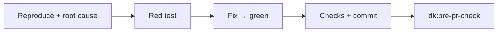
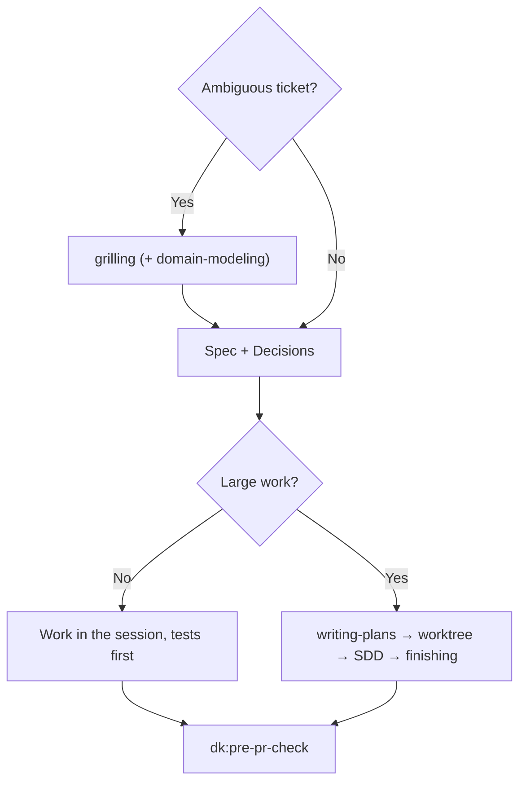

English | [Tiếng Việt](../vi/03-skills.md) | [简体中文](../zh-CN/03-skills.md) | [日本語](../ja/03-skills.md)

# 3. Skills

The four controllers share the same behavior blocks before their own steps:

| Block | Meaning |
|---|---|
| **Parts** | Read a part only when a step mentions it; parts are not skills |
| **Rules** | Apply the rules that are on in `rules/RULES.md`: F1, F2, C1, C2, G1, S1, O1 ([04](04-rules.md)) |
| **Graph** | If the repo has a codegraph/CRG index, use it per rule G1; if not, skip |
| **Commands** | Take the check commands and base branch from `.dev-kit/config.yml` if it exists; otherwise use `make check` or the repo's test command, and `main` |
| **Outputs** | Everything is written into `.dev-kit/` (rule O1); finish with a report per `templates/report.md`; severity uses the blocker/major/minor scale (rule S1) |

The examples below are **illustrations, not run** on your repo. Real examples are in the lab, see [06](06-evidence.md).

---

## 3.1 `dk:init`

**Use when:** using dev-kit for the first time on a machine or a repo; or when you want to re-check the setup.

**Principles:**
- Print the plan first, wait for your approval, then act.
- A re-run only checks and fills in what is missing; it does not overwrite existing files.
- Installing anything or changing anything outside the repo requires asking first.
- It contains no controller logic.

**Steps:**
1. **Machine:** check `git`, `gh`, `make`, `codegraph`, `code-review-graph` (with versions); list the enabled plugins and remind you to call `dk:<controller>` by name.
   - **Check the graph tools** with `scripts/install-graph-tools.sh --check`.
   - **If missing:** say so in the plan and ask once. If you agree, run `scripts/install-graph-tools.sh --install` (pinned versions; tools already present are left alone). If you decline, continue and write "G1 off" in the report.
   - **Never run** `codegraph install` or `code-review-graph install`: those two commands register MCP, hooks and instruction files.
2. **Detect commands:** from `Makefile`, `package.json`, `pyproject.toml`. Ask you to confirm, then write `.dev-kit/config.yml`.
3. **Create `.dev-kit/`** (specs, plans, reports). Ask which parts will be committed.
4. **Optional:** create `CONSTRAINTS.md` with the `constraint-driven-development` part (asks you for quality standards; there are default thresholds).
5. **Graph indexes, on by default** (part of the plan you approve):
   - run `codegraph init` and `code-review-graph build`;
   - for a large repo, report the disk size first and ask: roughly 150 MB and 600 MB per ~3,000 files;
   - add `.codegraph/` and `.code-review-graph/` to `.gitignore`, and write `graph.*` in `config.yml`.
6. **Baseline:** run tests and build once.
   - **Green:** record it in the report.
   - **Red:** report the count and the main failure groups, then ask you to choose: **stop** (fix first) or **accept as a known baseline**. If you accept, write `.dev-kit/baseline.md` (per `templates/baseline.md`) listing each failing test by name. From then on controllers count a run as failed only when a test **outside** this list fails (rule B1).
7. **Write `.dev-kit/init-report.md`.**

**Outputs:** `config.yml`, the `.dev-kit/` directory, the init report, optionally `CONSTRAINTS.md` and the graph indexes.

⚠️ `dk:init` **has never been run in the lab**. It is the first thing to try ([08](08-roadmap.md)).

---

## 3.2 `dk:bug-fixer`

**Use when:** a bug ticket, including performance bugs (something got slower after a change).

**Steps:**
1. **Reproduce and find the root cause.** For a hard bug or a performance bug, read the `systematic-debugging` or `diagnosing-bugs` part and follow it.
2. **Write a regression test** that fails for the right reason → fix at the root cause → test goes green.
3. **Run the check commands.** Commit; the message states the root cause.
4. **Run `dk:pre-pr-check`.**

**Outputs:** a fix commit with its test, a report, the pre-pr-check result.

**Not included:** a separate reproduction subagent or fix subagent (an older version had them; the lab showed they only cost more), and no worktree.

**Example (illustration):** ticket "An order with 2 promotions has its goods total drop to 0".
- The agent finds code that sums the percentages of all promotions, while the rule is to take only the highest promotion.
- It writes a test with two promotions, 60% and 50% (red), changes the code to `max`, runs the checks, and commits "fix: promotions must not stack".
- pre-pr-check: the diff is small, so it does a self-review and writes the report.

---

## 3.3 `dk:story-runner`

**Use when:** a feature/story ticket.

**Steps:**
1. **Clarify.** If the ticket is ambiguous, read the `grilling` part and ask you one question at a time. If there are new business terms, also read the `domain-modeling` part. Only when nobody can answer (headless run) does it pick a reasonable option itself and mark it as an assumption.
2. **Write the spec** `.dev-kit/specs/<feature>.md` per `templates/spec.md`: goal, rules, interface, acceptance criteria, out of scope, and a **Decisions** section (question, answer, who decided or "assumption").
3. **Follow rule C1:**
   - **Small work:** do it right in the session, tests first, one commit per behavior.
   - **Large work** (more than 3 tasks or several modules): use the parts in order: `writing-plans` → `using-git-worktrees` → `subagent-driven-development` → `finishing-a-development-branch` (merge back into the branch you are working on; no push/PR).
4. **Run `dk:pre-pr-check`.**

**Example (illustration):** ticket "A customer enters a discount code at checkout".
- grilling asks: one code or several per order, deducted before or after tax, and what to show for an invalid code.
- The spec records the answers in Decisions.
- It is small work (1 module), so it is done in the session: a test per rule, a commit per behavior; at the end it runs pre-pr-check.

---

## 3.4 `dk:code-refactor`

**Use when:** a tech-debt ticket: split, merge or move modules **without changing behavior**.

**Steps:**
1. **Fix the new interface.** If the boundaries are unclear, read the `codebase-design` part.
2. **Write characterization tests first**, at the public interface, pinning current behavior for every input. Pin behavior that looks like a bug too: record it in the report as "suspect bug" and **do not fix** it during the refactor.
3. **Follow rule C1:** for small work, move in small steps inside the session, check after each step, commit each step. For large work, use the SDD parts as story-runner does.
4. **Run `dk:pre-pr-check`.** The review checks "no behavior change" and the interface you fixed.

**Why pin even behavior that looks like a bug:** in the lab, a refactor ticket is graded by comparing behavior before and after on 300 random inputs. If you "fix a bug while you are there" during the refactor, behavior changes, and the reviewer cannot tell which part is the refactor and which is the bug fix.

---

## 3.5 `dk:pre-pr-check`

**Use when:** the branch is done and a PR is about to be opened. The other three controllers call it at the end on their own; you can also call it directly for a branch written by a person.

**Report-only mode:** if the request says "do not change code", it edits no file and skips step 4.

**Steps:**
1. **Run the check commands right now** and keep the output as Evidence. Read `git diff <base branch>...HEAD` for signs of lowered standards: new tests skipped, `noqa`/`ts-ignore` added, asserts removed, thresholds lowered.
2. **Pick the review level per rule C2:**

   | Level | When | What it does |
   |---|---|---|
   | Self-review | Diff ≤ 2 files and < 50 lines (measured with `git diff --shortstat`) | Read the `code-review` part and apply its two axes yourself; spawn no subagent |
   | 1 reviewer | Everything else | 1 general-purpose subagent that reads the `code-review` part |
   | 4 reviewers | You ask for it, or the diff touches auth/permissions, secrets, personal data, migrations, config/env | In parallel: 2 `code-review` reviewers (one axis each), `dk:security-auditor`, `dk:test-engineer` |

   Each reviewer receives the diff range and the spec/issue text, and returns `file:line | blocker/major/minor | reason`.
3. **Merge the results** into one table on the blocker/major/minor scale. If any blocker is still open, `Verdict: NO-GO`; otherwise `GO`.
4. **If there are blockers:** read the `receiving-code-review` part, fix with evidence (or push back with a reason), and go back to step 1. At most 2 rounds.
5. **Report with the findings table.** Unless in report-only mode, write `.dev-kit/reports/pr-body.md` per the `pr` part (Summary / Evidence / Merge Danger), with Evidence being the output of step 1.

**Example (illustration):** a "partial refund" branch touches permissions and personal data, so it runs 4 reviewers. The result is NO-GO with these blockers:
- a non-staff role can still issue refunds;
- a refund can be repeated many times;
- rounding goes up instead of down;
- the customer's email leaks into the audit log.

It comes with a file:line table and a drafted PR body.

---

## 3.6 The two persona agents

| Agent | What it checks | Source |
|---|---|---|
| `dk:security-auditor` | OWASP, secrets, authentication/authorization, dependencies with CVEs | agent-skills |
| `dk:test-engineer` | Coverage, edge cases, error paths; whether tests really check the right rule | agent-skills |

They are spawned only when pre-pr-check picks the 4-reviewer level. A persona does not call another persona.
