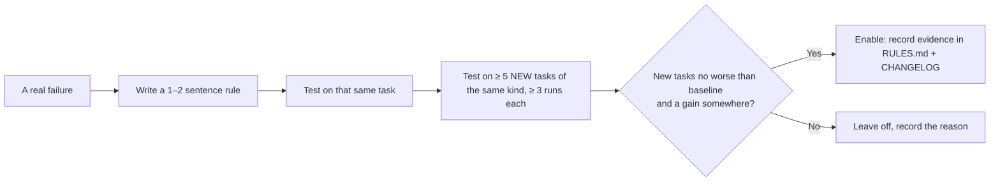

English | [Tiếng Việt](../vi/04-rules.md)

# 4. Rules

Source file: [`rules/RULES.md`](../../rules/RULES.md). This document explains why each rule exists.

## 4.1 Principles

- **A rule is switched on only with evidence:** it must make results more correct, or cheaper without making them worse, on tasks it has **never seen**.
- **Rules are short and cheap:** one or two sentences in a skill, not a multi-step procedure.
- **A wrong rule is fixed, and the reason is recorded** in `RULES.md` and `CHANGELOG.md`.

## 4.2 Active rules

### F1: Controller owns the flow

> When a part finishes, continue with the controller's next step; ignore part instructions to stop, hand off or wait for another command.

**Why:** parts copied from upstream kits were written for the context of those kits. In the lab, a controller that used only Matt Pocock's skills called `diagnosing-bugs`. That part found the right cause and then **stopped** ("stop before the fix step, as requested"), so the card was never fixed. Since this rule was added, the lab has not seen a mid-flow stop.

**Type:** prevents a process failure; does not raise quality.

### F2: Finish in this turn

> Run subagents in the foreground and wait for them in this turn; never use ScheduleWakeup, Monitor, cron or background waits. The final reply states what was done, the verdict and the report path.

**Why:** in 4 of 34 lab runs (v0.4.1–0.6.0) the agent scheduled a wakeup to wait for reviewers. In one run the final reply was "stopped the automatic loop" instead of a conclusion, although the report file was complete. A real user would never see the verdict.

**Type:** prevents a process failure.

### G1: Graph tools when indexed (optional)

> If `.codegraph/` exists: `codegraph sync`, then `explore`/`callers`/`impact` to locate code and `affected` to choose tests. If `.code-review-graph/` exists: `pre-pr-check` runs `update` + `detect-changes --brief` once and gives the summary to the reviewer. CLI only.

**Evidence (17 SWE Django runs, Haiku 5.5):**

| | No index | With index |
|---|---|---|
| Tasks solved | 10/17 | 10/17 |
| USD/run | 0.033 | 0.034 |
| codegraph / CRG commands actually run | 0 / 0 | 27 / 33 |
| grep commands | 58 | 31 |

**0.8.0 (playbook, 17 runs with indexes):** 12/17 at 0.031 USD/run, against 10/17 at 0.034 for 0.7. No extra cost; the +2 tasks are within noise.

**Type:** neutral; no measurable gain or loss. Kept optional because it is cheap and runs only when you have built an index. Worth measuring again on larger or unfamiliar repos, where finding code is the hard part.

### C1: Default to the direct path

> Do the work in this session. Use subagent-driven development (SDD) only for large work (more than 3 tasks or several modules).

**Why:** SDD spawns an implementer and a reviewer for every task, which is most of the cost. With the same hidden-test results:
- S1 dropped from 0.463 to 0.062 USD;
- S2 dropped from 0.227 to 0.064 USD.

**Type:** saves cost without making results worse.

### C2: Review depth

> Small diff (≤ 2 files, < 50 lines): self-review. Otherwise: one reviewer. Four reviewers only when the user asks, or the diff touches auth/permissions, secrets, personal data, migrations or config/env. Computing prices is not a trigger.

**Why:**
- **Four reviewers found no more defects:** on 3 pre-PR cards with seeded defects, the run without a controller already caught all 5 of 5 defects on each card.
- **Pricing is not counted as risk:** version 0.4.0 treated pricing as risky. Because the sample app is a shopping cart, almost every card ran four reviewers; cost rose 3–4× with no quality gain.
- **Four reviewers are kept for risky diffs:** this is a safety margin; its benefit has not been measured.

**Type:** saves cost and keeps a safety margin for risky diffs.

## 4.3 Standards (always on)

### S1: One severity scale

> `blocker` (must fix before merge), `major` (should fix before merge), `minor` (optional). Map other labels: Critical/High → blocker; Important/Medium → major; Minor/Low/Info/Nit → minor. Any open blocker → NO-GO.

**Why:** the parts copied from upstream used four different scales:
- the Superpowers reviewer: Critical/Important/Minor;
- `security-auditor`: Critical/High/Medium/Low/Info;
- `test-engineer`: its own priority scale;
- the controller: blocker/major/minor.

Merging their results was confusing. Since 0.6.0, the reviewer prompts and agent personas have been changed to share one scale.

### O1: One output home

> Everything dev-kit writes goes under `.dev-kit/`, filled from `templates/`. Exceptions, on purpose: `GLOSSARY.md`, `docs/adr/`, `CONSTRAINTS.md` (the project's own documents). Never edit `CLAUDE.md`/`AGENTS.md` without asking.

**Why:** an audit on 2026-10-13 found 3 deviations.
- The SDD ledger was written to `.superpowers/sdd/`.
- `code-review` did not look for specs in `.dev-kit/specs/`.
- `constraint-driven-development` edited `CLAUDE.md` on its own.

### B1: Known-failure baseline

> If tests were already red at `dk:init` and you accepted them, `.dev-kit/baseline.md` lists them. A check passes when nothing fails outside the list. New failures are blockers. Never add to the list to make a change pass.

**Why:** tried on a real repo (an Angular micro-frontend, about 9,500 specs), the base branch already had 290–303 failing specs. Without this rule `dk:init` stops and no controller can run.

## 4.4 Rules that are off (experimental)

### Q1: Sibling check

> A new field or parameter must be handled wherever its siblings are handled: `__repr__`, `__eq__`, `deconstruct`, sync/async twins, docs, tests.

**Why it is off:**
- On SWE task 16560, this rule raised the solve rate from 3/6 to 6/6. A single rule line in the prompt, with no controller, also reached 6/6.
- But the rule was written **after** seeing that same task fail. On 5 new tasks of the same kind it scored 10/15, against 11/16 without the rule: no help.
- This is a case of **overfitting**.

### Q2: Read ADRs first; the newest decision wins

**Why it is off:** on a card where an old note contradicted an ADR, the run without the rule already chose the ADR. No effect has been measured.

## 4.5 How to add or enable a rule

Measure with the dev-kit lab (private):
- `scripts/run.sh` for cards on the sample app;
- `scripts/run_swe.sh` for SWE-bench tasks;
- the `bsib` variant is the template for the "baseline + one rule line" test.
