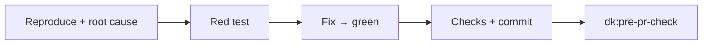
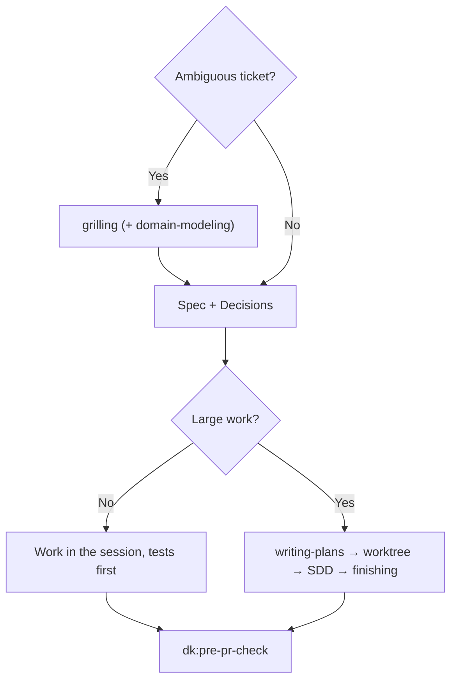

<!-- i18n: source=docs/en/03-skills.md source_commit=v1.4.3 review=machine -->
[English](../en/03-skills.md) | [Tiếng Việt](../vi/03-skills.md) | [简体中文](../zh-CN/03-skills.md) | 日本語

> この翻訳は英語版より遅れる場合があります。正式な内容は英語版です: [03-skills.md](../en/03-skills.md)

# 3. Skills

4 つの controller は、それぞれ固有のステップの前に、共通の動作ブロックを持っています。

| ブロック | 意味 |
|---|---|
| **Parts** | ステップで言及されたときだけ part を読む。part は skill ではない |
| **Rules** | `rules/RULES.md` で on になっている rule を適用する: F1、F2、C1、C2、G1、S1、O1（[04](../en/04-rules.md)、英語） |
| **Graph** | リポジトリに codegraph/CRG のインデックスがあれば rule G1 に従って使い、なければ省略する |
| **Commands** | `.dev-kit/config.yml` があればそこからチェックコマンドとベースブランチを取る。なければ `make check` またはリポジトリのテストコマンドと `main` を使う |
| **Outputs** | すべて `.dev-kit/` に書く（rule O1）。`templates/report.md` に沿ったレポートで終える。重大度は blocker/major/minor の尺度を使う（rule S1） |

以下の例は**説明用で、実行はされていません**。実際の例は lab にあります。[06](../en/06-evidence.md)（英語）を参照してください。

---

## 3.1 `dk:init`

**使う場面:** マシンまたはリポジトリで初めて dev-kit を使うとき。セットアップを再確認するとき。または 1 つの部分だけやり直すとき: `dk:init index`（例えば新しい worktree で）、`dk:init baseline`、`dk:init standards [rules|review]`。

**原則:**
- **まず調査し、そのあと質問を 1 つずつ、決まった順番で行う。** 各質問には、エージェントが見つけたもの、既定値、短い選択肢が示され、あなたの答えを待ってから次へ進む。「default」と「skip」は常に使える。コードがすでに答えているものは決して尋ねない。
- 再実行では、足りないものを確認して補うだけで、既存のファイルは上書きしない。
- 何かをインストールしたり、リポジトリの外を変更したりするときは、事前に確認する。
- `.dev-kit/` は個人用: 作成したものは一切コミットされず、`.gitignore` のような追跡されているファイルも編集しない。
- controller のロジックは含まない。

**ステップと質問（順番どおり）:**
1. **グラフツール:** `scripts/install-graph-tools.sh --check` で確認する。*質問は、足りないものがあるときだけ:* インストールするか。断られた場合は「G1 off」で続行する。`codegraph install` と `code-review-graph install` は決して実行しない（MCP、hook、指示ファイルを登録するため）。
2. **個人設定:** 以前のリポジトリでチームの standards フォルダが保存されていれば、`~/.dev-kit/config.yml` から読み込む。
3. **調査のみ、質問なし:** コマンド、ベースブランチ、スタック、linter がすでに強制しているもの、すでに `.dev-kit/` の下で追跡されているファイル、プロジェクト自身の `GLOSSARY.md`、`docs/adr/`、`CONSTRAINTS.md`。
4. *質問:* **コマンドとベースブランチ**（確認または修正）。そのあと `*` を含む `.gitignore` を置いた `.dev-kit/` を作成し、`config.yml` を書く。
5. *質問:* **グラフのインデックス**（既定は yes。大きなリポジトリで想定されるサイズ: 約 3,000 ファイルあたり、およそ 150 MB と 600 MB）。インデックスのフォルダが `git status` にまだ表示される場合（codegraph は自身の `.gitignore` を表示されたままにする）は、`.git/info/exclude` に追加する。
6. **Baseline:** テストとビルドを一度実行する。*質問は red のときだけ:* **停止**（先に直す）か、**既知の baseline として受け入れる**か。受け入れた場合は `.dev-kit/baseline.md` に書かれ、以後は、そのリストの**外**のテストが失敗したときだけ実行が失敗となる（rule B1）。テストが**実行できなかった**場合（パッケージの復元、認証、不足しているサービスなど）は、その旨を伝え、停止するか、`config.yml` で baseline を `not-measured` にしたまま続行するかを尋ねる。環境が整ったら `dk:init baseline` を再実行する。
7. **2 つのパスに分けた standards**（下記）。
8. *質問:* **`CONSTRAINTS.md`**（任意、既定は no）→ `.dev-kit/CONSTRAINTS.md`。プロジェクトに独自のものがある場合はスキップする。質問では、このファイルがあなたのリポジトリに何を加えるかを説明する（下記）。
9. **レポート** `.dev-kit/init-report.md`。そして `git status` が変わっていないことの確認。

**2 つのパスに分けた standards**（設計: [09](../en/09-init-and-standards.md)、英語、セクション 9.6）。rule を書くのは、エージェントが知り得ないこと、または誤りやすいことが確認されたことだけで、命名やスタイルは対象外。
- **まず調査:** linter とコンパイラがカバーしている範囲、構造（レイヤー、データへのアクセス方法、モジュール、公開されているコントラクト、設定、権限キー。グラフで見つける）、社内ライブラリ（社内パッケージ、フレームワークのコントロールに対して何ファイルが使っているか、最近のファイルが何を使っているか、そのコンポーネント一覧）。
- **ブレインストームのように、質問ごとに 1 グループ:** そのグループの一覧を詳しく示し（各項目について、何を求めるか、なぜか、このリポジトリのどこに当てはまるか。数は agent が実行したコマンドから得たもの。kit ファイルには `validated` か `experimental` を付ける）、そのあとに各部分に理由を 1 つ付けた **Recommended** の行を示す。「default」は Recommended を表示どおりに受け入れ、「skip」は何も採用せず、または項目ごとに答える。残したものはすべてこのリポジトリに属する。プロジェクトかチームかは尋ねない（現時点では 1 リポジトリずつ）。使用状況の根拠のない「X は Y を置き換える」という主張は、選択肢として尋ねられる。
- **パス 1、コードを書くための rule**（`## Design`/`## Implement`。story-runner、bug-fixer、code-refactor が使う）:
  1. **Architecture:** 調査が標準の一覧になる（原則 0 により kit に architecture のファイルはない）。近くのコードがすでに示していることは勧めない。
  2. リポジトリに合う Implement の項目を持つ kit ファイルごとに 1 グループ: `coding/review-basics`、`testing/basics`、`security/web`、`ui/forms-and-actions`。
  3. 社内ライブラリごとに 1 グループ（古いバージョンをまだ許可するか、どのフレームワークのコントロールを引き続き許可するか）。
  4. **あなた自身の規約（ループ）:** 調査から得たその他の提案と自由入力、そのあと、あなたが no と答えるまで、答えるたびに質問する。質問は文脈から組み立て、「ほかに何かありますか?」だけの質問にはしない: 直前に追加したもの、残した rule がカバーする範囲、まだどの rule も触れていない領域を最大 3 つ（根拠つき。例: 日付の扱いと、そのライブラリとファイル数）、そしてそれらの領域を名指しする質問 1 つ。

  そのあと、パス 1 の rule を読み返してあなたの確認を取り、書き込む。
- **パス 2、レビューのチェックリスト**（`## Review`/`## Do not flag`/`## Severity`。pre-pr-check が使う）: パス 1 で残した rule は再び尋ねず、それぞれが自身の severity で確認される。`review/finding-quality` は常にオン。
  1. 残した rule の **severity**（kit の項目は自身のものを保つ。リポジトリの rule には agent が 1 つずつ提案する）。
  2. **レビュー専用のチェック**（「diff が X に触れるときは Y を確認する」）。パス 1 の rule の言い換えにはしない。
  3. **Do not flag:** linter、コンパイラ、CI が強制していること、kit の行、リポジトリのノイズ。
  4. **あなた自身のチェック（ループ）**。パス 1 と同じ。

  そのあと、チェックリストを読み返し、同じトピックのファイルに書き込む。
- **あなたが自分の言葉で追加したものは、まず確認する:** agent は書き込む形のまま起草し（トリガー、適用範囲、新しいコードだけか既存コードも含むか、例外、深刻度、スコープ）、コードと照らし合わせ（従っている箇所と従っていない箇所の数、衝突、ツールや残した rule がすでにカバーしているか、レビュアーが確認できるか）、「この意味で合っていますか?」と尋ねる: 草稿どおり、より狭く、より広く、またはあなたの修正。
- 質問数の上限はない: ループはあなたが no と答えると終わる。headless の実行では各 Recommended の行をそのまま採用し、ループを終える。1 つのパスだけやり直すには `dk:init standards rules` または `dk:init standards review`。

**Kit の standards**（新しいバグで測定するまですべて `experimental`）: `review/finding-quality`（常にオン）、`coding/review-basics`、`security/web`（OWASP Top 10:2025、ASVS 5.0）、`testing/basics`、`ui/forms-and-actions`（WCAG 2.2）。

**`CONSTRAINTS.md` と standards の違い。** どちらもセットアップの任意の部分ですが、答える問いが異なります:

| | Standards（`.dev-kit/standards/`） | `CONSTRAINTS.md` |
|---|---|---|
| 答える問い | このリポジトリではコードをどう書くか? | 変更はリリース前にどれだけ良くなければならないか? |
| 内容 | エージェントが推測できない rule。トピックごとで ID 付き（例: 「社内コントロールを使う」） | 各項目を検査するコマンド付きの数値（例: 「型エラーゼロ: `tsc --noEmit`」、「変更行のカバレッジ ≥ 80%」）、常に適用される下限（新しい `@ts-ignore`、stub、スキップされたテスト、secrets を入れない）、合意済みの例外 |
| 使われる場面 | 計画、コーディング、レビュー | `dk:pre-pr-check` のステップ 1: これを破る変更は blocker になる |
| 目的 | リポジトリに合うコード | エージェントが green にするために基準をこっそり下げられないようにする |

`CONSTRAINTS.md` がなくても、`dk:pre-pr-check` は差分内の新しいスキップ、抑制、削除された assert、緩められたしきい値を指摘します。このファイルが加えるのは、リポジトリがまだチェックしていない項目（カバレッジ、型エラー、セキュリティスキャン、パフォーマンスやアクセシビリティの予算）に対する数値のゲートです。質問が最大 4 つ増え（どの項目か、block か warn か、目標数値か「今日測定してそれを維持」か、許容できる最も遅いチェック）、ツールのインストールが必要になる場合もありますが、その場合は必ず先に尋ねます。この効果は dev-kit の lab では測定されていないため、既定は no です。この質問は `constraint-driven-development` の part（agent-skills）に由来します。

**出力:** `config.yml`、`.dev-kit/` ディレクトリ、あなたが選んだ standards、init のレポート。任意で `.dev-kit/CONSTRAINTS.md` とグラフのインデックス。コミットするものはありません。

---

## 3.2 `dk:bug-fixer`

**使う場面:** バグのチケット（パフォーマンスのバグ、つまり変更後に遅くなったものを含む）。

**ステップ:**
1. **再現し、根本原因を見つける。** 難しいバグやパフォーマンスのバグでは、`systematic-debugging` または `diagnosing-bugs` part を読んで従う。
2. **回帰テストを書く。** 正しい理由で失敗すること → 根本原因を修正する → テストが green になる。
3. **チェックコマンドを実行する。** コミットする。メッセージには根本原因を書く。
4. **`dk:pre-pr-check` を実行する。**

**出力:** 修正のコミットとそのテスト、レポート、pre-pr-check の結果。

**含まないもの:** 再現専用の subagent や修正専用の subagent（古いバージョンにはありましたが、lab でコストが増えるだけと分かりました）。また worktree も使いません。

**例（説明用）:** チケット「プロモーションが 2 つ付いた注文で、商品の合計が 0 になる」。
- エージェントは、すべてのプロモーションの割合を合計しているコードを見つける。しかし本来の仕様は、最も高いプロモーションだけを採用することである。
- 60% と 50% の 2 つのプロモーションでテストを書き（red）、コードを `max` に変更し、チェックを実行して、「fix: promotions must not stack」でコミットする。
- pre-pr-check: diff が小さいので self-review を行い、レポートを書く。

---

## 3.3 `dk:story-runner`

**使う場面:** 機能/ストーリーのチケット。

**ステップ:**
1. **明確化する。** チケットが曖昧なら、`grilling` part を読み、一度に 1 つずつあなたに質問する。新しい業務用語があれば、`domain-modeling` part も読む。誰も答えられない場合（headless の実行）にだけ、妥当な選択肢を自分で選び、前提（assumption）として記録する。
2. **spec を書く** `.dev-kit/specs/<feature>.md`、`templates/spec.md` に沿って: 目的、rule、インターフェース、受け入れ基準、スコープ外、そして **Decisions** セクション（質問、回答、決めた人または「assumption」）。
3. **rule C1 に従う:**
   - **小さな作業:** セッション内でそのまま行う。テストを先に書き、振る舞いごとに 1 コミット。
   - **大きな作業**（タスクが 3 つより多い、または複数のモジュールにまたがる）: part を順に使う: `writing-plans` → `using-git-worktrees` → `subagent-driven-development` → `finishing-a-development-branch`（作業中のブランチにマージして戻す。push/PR はしない）。
4. **`dk:pre-pr-check` を実行する。**

**例（説明用）:** チケット「顧客がチェックアウトで割引コードを入力する」。
- grilling が尋ねる: 注文ごとにコードは 1 つか複数か、税の前に差し引くか後か、無効なコードのときに何を表示するか。
- spec は回答を Decisions に記録する。
- 小さな作業（モジュール 1 つ）なのでセッション内で行う: rule ごとにテスト、振る舞いごとにコミット。最後に pre-pr-check を実行する。

---

## 3.4 `dk:code-refactor`

**使う場面:** 技術的負債のチケット: **振る舞いを変えずに**モジュールを分割、統合、移動する。

**ステップ:**
1. **新しいインターフェースを固める。** 境界が不明確なら、`codebase-design` part を読む。
2. **まず characterization test を書く。** 公開インターフェースで、あらゆる入力について現在の振る舞いを固定する。バグに見える振る舞いも固定する: レポートに「suspect bug」として記録し、リファクタリング中は**修正しない**。
3. **rule C1 に従う:** 小さな作業では、セッション内で小さなステップで進め、各ステップの後にチェックし、各ステップをコミットする。大きな作業では、story-runner と同じように SDD の part を使う。
4. **`dk:pre-pr-check` を実行する。** レビューでは、「振る舞いの変更がないこと」と、固めたインターフェースを確認する。

**バグに見える振る舞いまで固定する理由:** lab では、リファクタリングのチケットを、300 件のランダムな入力でリファクタリング前後の振る舞いを比べて採点します。リファクタリング中に「ついでにバグを直す」と振る舞いが変わり、レビュアーはどこがリファクタリングでどこがバグ修正なのか判別できなくなります。

---

## 3.5 `dk:pre-pr-check`

**使う場面:** ブランチが完成し、これから PR を開くとき。他の 3 つの controller は最後に自分でこれを呼び出します。人が書いたブランチに対して直接呼び出すこともできます。

**Report-only モード:** リクエストに「コードを変更しない」とあれば、ファイルを編集せず、ステップ 4 を省略する。

**ステップ:**
1. **チェックコマンドを今すぐ実行し**、出力を Evidence として残す。`git diff <base branch>...HEAD` を読み、基準引き下げの兆候を探す: 新しいテストがスキップされている、`noqa`/`ts-ignore` が追加されている、assert が削除されている、しきい値が下げられている。
2. **rule C2 に従ってレビューのレベルを選ぶ:**

   | レベル | 場面 | 内容 |
   |---|---|---|
   | Self-review | diff が 2 ファイル以下かつ 50 行未満（`git diff --shortstat` で測定） | `code-review` part を読み、その 2 つの軸を自分で適用する。subagent は起動しない |
   | 1 reviewer | それ以外すべて | `code-review` part を読む汎用の subagent を 1 つ |
   | 4 reviewers | あなたが求めたとき、または diff が auth/権限、シークレット、個人データ、マイグレーション、config/env に触れるとき | 並列で: `code-review` のレビュアー 2 人（それぞれ 1 軸）、`dk:security-auditor`、`dk:test-engineer` |

   各レビュアーは diff の範囲と spec/issue の文面を受け取り、`file:line | blocker/major/minor | reason` を返す。
3. **結果を統合して** blocker/major/minor の尺度で 1 つの表にする。blocker が 1 つでも未解決なら `Verdict: NO-GO`、そうでなければ `GO`。
4. **blocker がある場合:** `receiving-code-review` part を読み、根拠を示して修正する（または理由を添えて反論する）。そしてステップ 1 に戻る。最大 2 ラウンド。
5. **finding の表を付けてレポートする。** report-only モードでなければ、`pr` part に沿って `.dev-kit/reports/pr-body.md` を書く（Summary / Evidence / Merge Danger）。Evidence はステップ 1 の出力にする。

**例（説明用）:** 「部分返金」のブランチが権限と個人データに触れるため、4 reviewers で実行する。結果は NO-GO で、blocker は次のとおり:
- スタッフ以外のロールでも返金できてしまう。
- 返金を何度でも繰り返せる。
- 丸めが切り捨てではなく切り上げになっている。
- 顧客のメールアドレスが監査ログに漏れている。

file:line の表と、下書きの PR 本文が付く。

---

## 3.6 2 つのペルソナエージェント

| エージェント | 確認すること | ソース |
|---|---|---|
| `dk:security-auditor` | OWASP、シークレット、認証/認可、CVE のある依存関係 | agent-skills |
| `dk:test-engineer` | カバレッジ、エッジケース、エラーパス。テストが本当に正しい rule を確認しているか | agent-skills |

pre-pr-check が 4 reviewers のレベルを選んだときにだけ起動されます。ペルソナが別のペルソナを呼び出すことはありません。
