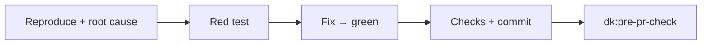
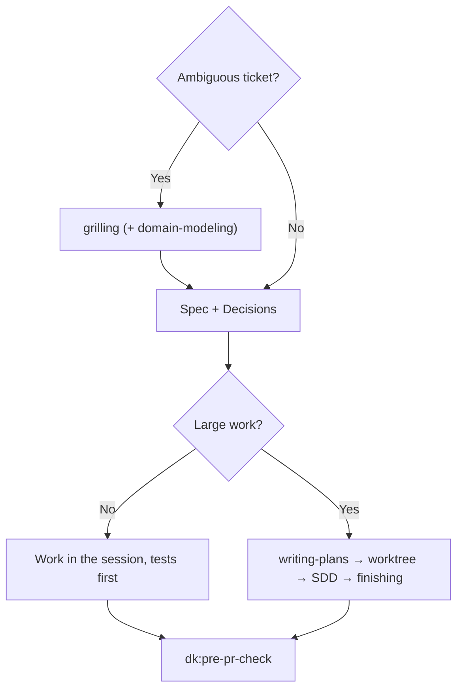

<!-- i18n: source=docs/en/03-skills.md source_commit=v1.1.0 review=machine -->
[English](../en/03-skills.md) | [Tiếng Việt](../vi/03-skills.md) | [简体中文](../zh-CN/03-skills.md) | 日本語

> この翻訳は英語版より遅れる場合があります。正式な内容は英語版です: [03-skills.md](../en/03-skills.md)

# 3. Skills

4 つの controller は、それぞれ固有のステップの前に、共通の動作ブロックを持っています。

| ブロック | 意味 |
|---|---|
| **Parts** | ステップで言及されたときだけ part を読む。part は skill ではない |
| **Rules** | `rules/RULES.md` で on になっている rule を適用する: F1、F2、C1、C2、G1、S1、O1（[04](../en/04-rules.md)、英語） |
| **Graph** | リポジトリに codegraph/CRG のインデックスがあれば rule G1 に従って使い、なければ省略する |
| **Commands** | `.dev-kit/config.yml` があればそこからチェックコマンドとベースブランチを取る。なければ `make check` またはリポジトリのテストコマンドと `main` を使う |
| **Outputs** | すべて `.dev-kit/` に書く（rule O1）。`templates/report.md` に沿ったレポートで終える。重大度は blocker/major/minor の尺度を使う（rule S1） |

以下の例は**説明用で、実行はされていません**。実際の例は lab にあります。[06](../en/06-evidence.md)（英語）を参照してください。

---

## 3.1 `dk:init`

**使う場面:** マシンまたはリポジトリで初めて dev-kit を使うとき。またはセットアップを再確認したいとき。

**原則:**
- 既定値を入れた計画を 1 つ表示し、あなたの承認（1 回の返答）を待ってから実行する。別に確認するのは、ツールが足りないときと baseline が red のときだけ。
- 再実行では、足りないものを確認して補うだけで、既存のファイルは上書きしない。
- 何かをインストールしたり、リポジトリの外を変更したりするときは、事前に確認する。
- `.dev-kit/` は個人用: 作成したものは一切コミットされず、`.gitignore` のような追跡されているファイルも編集しない。
- controller のロジックは含まない。

**ステップ:**
1. **マシン:** `git`、`gh`、`make`、`codegraph`、`code-review-graph` を（バージョンとともに）確認する。有効な plugin を一覧し、`dk:<controller>` を名前で呼び出すよう案内する。
   - **グラフツールの確認**は `scripts/install-graph-tools.sh --check` で行う。
   - **足りない場合:** 計画にそのことを書き、一度だけ確認する。同意すれば `scripts/install-graph-tools.sh --install` を実行する（バージョン固定。すでにあるツールはそのまま）。断られた場合は続行し、レポートに「G1 off」と書く。
   - **決して実行しない:** `codegraph install` と `code-review-graph install`。この 2 つのコマンドは MCP、hook、指示ファイルを登録します。
2. **コマンドの検出:** `Makefile`、`package.json`、`pyproject.toml` から検出する。計画に示したうえで `.dev-kit/config.yml` を書く。
3. **`.dev-kit/` を作成**（specs、plans、reports）。`*` を含む `.gitignore` を置き、git がフォルダ全体を無視するようにする。コミットについて決めることはない。
4. **任意**（既定は no。計画の中で尋ねる）: `constraint-driven-development` part で `.dev-kit/CONSTRAINTS.md` を作成する（品質基準を尋ねる。既定のしきい値もある）。
5. **グラフのインデックス。既定で on**（承認する計画の一部）:
   - `codegraph init` と `code-review-graph build` を実行する。
   - 大きなリポジトリでは、計画にディスクサイズを示す: 約 3,000 ファイルあたり、およそ 150 MB と 600 MB。
   - リポジトリの `.gitignore` には触れない: インデックスのフォルダが `git status` にまだ表示される場合（codegraph は自身の `.gitignore` を表示されたままにする）は、clone ローカルの `.git/info/exclude` に追加する。`config.yml` に `graph.*` を書く。
6. **Baseline:** テストとビルドを一度実行する。
   - **Green:** レポートに記録する。
   - **Red:** 件数と主な失敗グループを報告し、あなたに選んでもらう: **停止**（先に直す）か、**既知の baseline として受け入れる**か。受け入れる場合は、失敗しているテストを名前で列挙した `.dev-kit/baseline.md`（`templates/baseline.md` に沿う）を書く。以後 controller は、このリストの**外**のテストが失敗したときだけ、その実行を失敗とみなす（rule B1）。
7. **`.dev-kit/init-report.md` を書き**、`git status` が `dk:init` の前と変わっていないことを確認する。

**出力:** `config.yml`、`.dev-kit/` ディレクトリ、init のレポート。任意で `.dev-kit/CONSTRAINTS.md` とグラフのインデックス。コミットするものはありません。

⚠️ `dk:init` は **lab で一度も実行されていません**。最初に試すべきものです（[08](../en/08-roadmap.md)、英語）。

---

## 3.2 `dk:bug-fixer`

**使う場面:** バグのチケット（パフォーマンスのバグ、つまり変更後に遅くなったものを含む）。

**ステップ:**
1. **再現し、根本原因を見つける。** 難しいバグやパフォーマンスのバグでは、`systematic-debugging` または `diagnosing-bugs` part を読んで従う。
2. **回帰テストを書く。** 正しい理由で失敗すること → 根本原因を修正する → テストが green になる。
3. **チェックコマンドを実行する。** コミットする。メッセージには根本原因を書く。
4. **`dk:pre-pr-check` を実行する。**

**出力:** 修正のコミットとそのテスト、レポート、pre-pr-check の結果。

**含まないもの:** 再現専用の subagent や修正専用の subagent（古いバージョンにはありましたが、lab でコストが増えるだけと分かりました）。また worktree も使いません。

**例（説明用）:** チケット「プロモーションが 2 つ付いた注文で、商品の合計が 0 になる」。
- エージェントは、すべてのプロモーションの割合を合計しているコードを見つける。しかし本来の仕様は、最も高いプロモーションだけを採用することである。
- 60% と 50% の 2 つのプロモーションでテストを書き（red）、コードを `max` に変更し、チェックを実行して、「fix: promotions must not stack」でコミットする。
- pre-pr-check: diff が小さいので self-review を行い、レポートを書く。

---

## 3.3 `dk:story-runner`

**使う場面:** 機能/ストーリーのチケット。

**ステップ:**
1. **明確化する。** チケットが曖昧なら、`grilling` part を読み、一度に 1 つずつあなたに質問する。新しい業務用語があれば、`domain-modeling` part も読む。誰も答えられない場合（headless の実行）にだけ、妥当な選択肢を自分で選び、前提（assumption）として記録する。
2. **spec を書く** `.dev-kit/specs/<feature>.md`、`templates/spec.md` に沿って: 目的、rule、インターフェース、受け入れ基準、スコープ外、そして **Decisions** セクション（質問、回答、決めた人または「assumption」）。
3. **rule C1 に従う:**
   - **小さな作業:** セッション内でそのまま行う。テストを先に書き、振る舞いごとに 1 コミット。
   - **大きな作業**（タスクが 3 つより多い、または複数のモジュールにまたがる）: part を順に使う: `writing-plans` → `using-git-worktrees` → `subagent-driven-development` → `finishing-a-development-branch`（作業中のブランチにマージして戻す。push/PR はしない）。
4. **`dk:pre-pr-check` を実行する。**

**例（説明用）:** チケット「顧客がチェックアウトで割引コードを入力する」。
- grilling が尋ねる: 注文ごとにコードは 1 つか複数か、税の前に差し引くか後か、無効なコードのときに何を表示するか。
- spec は回答を Decisions に記録する。
- 小さな作業（モジュール 1 つ）なのでセッション内で行う: rule ごとにテスト、振る舞いごとにコミット。最後に pre-pr-check を実行する。

---

## 3.4 `dk:code-refactor`

**使う場面:** 技術的負債のチケット: **振る舞いを変えずに**モジュールを分割、統合、移動する。

**ステップ:**
1. **新しいインターフェースを固める。** 境界が不明確なら、`codebase-design` part を読む。
2. **まず characterization test を書く。** 公開インターフェースで、あらゆる入力について現在の振る舞いを固定する。バグに見える振る舞いも固定する: レポートに「suspect bug」として記録し、リファクタリング中は**修正しない**。
3. **rule C1 に従う:** 小さな作業では、セッション内で小さなステップで進め、各ステップの後にチェックし、各ステップをコミットする。大きな作業では、story-runner と同じように SDD の part を使う。
4. **`dk:pre-pr-check` を実行する。** レビューでは、「振る舞いの変更がないこと」と、固めたインターフェースを確認する。

**バグに見える振る舞いまで固定する理由:** lab では、リファクタリングのチケットを、300 件のランダムな入力でリファクタリング前後の振る舞いを比べて採点します。リファクタリング中に「ついでにバグを直す」と振る舞いが変わり、レビュアーはどこがリファクタリングでどこがバグ修正なのか判別できなくなります。

---

## 3.5 `dk:pre-pr-check`

**使う場面:** ブランチが完成し、これから PR を開くとき。他の 3 つの controller は最後に自分でこれを呼び出します。人が書いたブランチに対して直接呼び出すこともできます。

**Report-only モード:** リクエストに「コードを変更しない」とあれば、ファイルを編集せず、ステップ 4 を省略する。

**ステップ:**
1. **チェックコマンドを今すぐ実行し**、出力を Evidence として残す。`git diff <base branch>...HEAD` を読み、基準引き下げの兆候を探す: 新しいテストがスキップされている、`noqa`/`ts-ignore` が追加されている、assert が削除されている、しきい値が下げられている。
2. **rule C2 に従ってレビューのレベルを選ぶ:**

   | レベル | 場面 | 内容 |
   |---|---|---|
   | Self-review | diff が 2 ファイル以下かつ 50 行未満（`git diff --shortstat` で測定） | `code-review` part を読み、その 2 つの軸を自分で適用する。subagent は起動しない |
   | 1 reviewer | それ以外すべて | `code-review` part を読む汎用の subagent を 1 つ |
   | 4 reviewers | あなたが求めたとき、または diff が auth/権限、シークレット、個人データ、マイグレーション、config/env に触れるとき | 並列で: `code-review` のレビュアー 2 人（それぞれ 1 軸）、`dk:security-auditor`、`dk:test-engineer` |

   各レビュアーは diff の範囲と spec/issue の文面を受け取り、`file:line | blocker/major/minor | reason` を返す。
3. **結果を統合して** blocker/major/minor の尺度で 1 つの表にする。blocker が 1 つでも未解決なら `Verdict: NO-GO`、そうでなければ `GO`。
4. **blocker がある場合:** `receiving-code-review` part を読み、根拠を示して修正する（または理由を添えて反論する）。そしてステップ 1 に戻る。最大 2 ラウンド。
5. **finding の表を付けてレポートする。** report-only モードでなければ、`pr` part に沿って `.dev-kit/reports/pr-body.md` を書く（Summary / Evidence / Merge Danger）。Evidence はステップ 1 の出力にする。

**例（説明用）:** 「部分返金」のブランチが権限と個人データに触れるため、4 reviewers で実行する。結果は NO-GO で、blocker は次のとおり:
- スタッフ以外のロールでも返金できてしまう。
- 返金を何度でも繰り返せる。
- 丸めが切り捨てではなく切り上げになっている。
- 顧客のメールアドレスが監査ログに漏れている。

file:line の表と、下書きの PR 本文が付く。

---

## 3.6 2 つのペルソナエージェント

| エージェント | 確認すること | ソース |
|---|---|---|
| `dk:security-auditor` | OWASP、シークレット、認証/認可、CVE のある依存関係 | agent-skills |
| `dk:test-engineer` | カバレッジ、エッジケース、エラーパス。テストが本当に正しい rule を確認しているか | agent-skills |

pre-pr-check が 4 reviewers のレベルを選んだときにだけ起動されます。ペルソナが別のペルソナを呼び出すことはありません。
