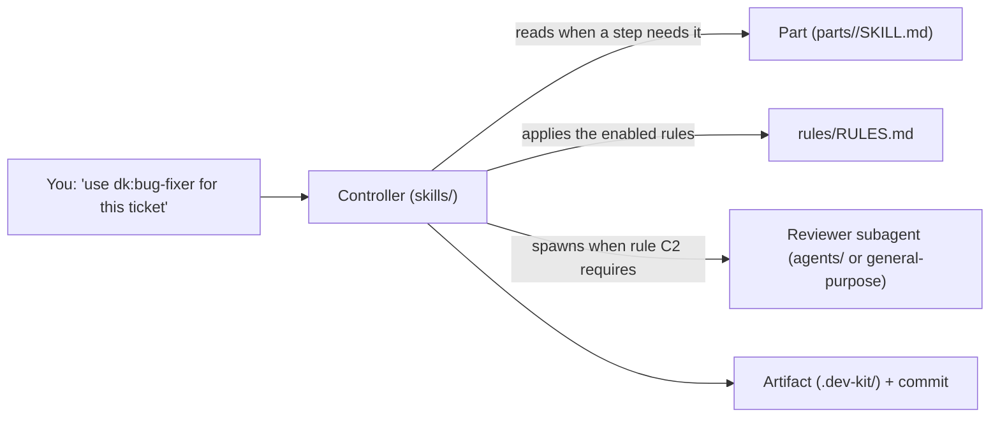
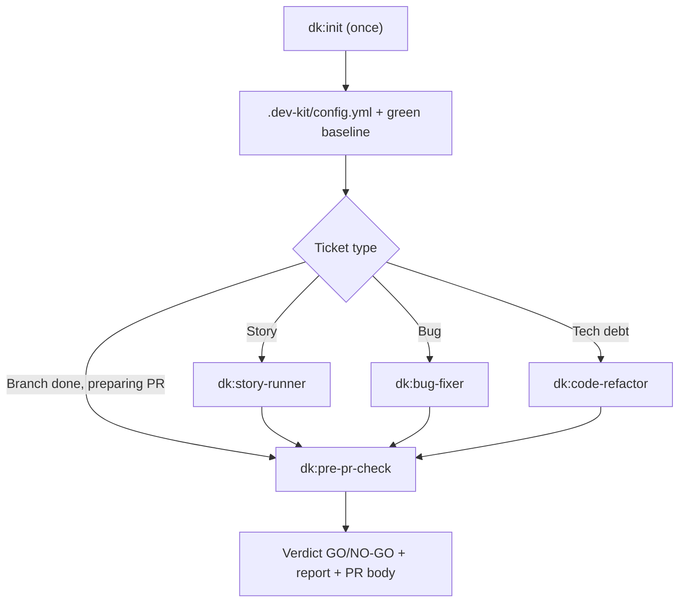

<!-- i18n: source=docs/en/02-architecture.md source_commit=v1.7.1 review=human -->
[English](../en/02-architecture.md) | Tiếng Việt

> Bản dịch này có thể chậm hơn bản tiếng Anh; bản tiếng Anh là bản chính thức. Xem [bản tiếng Anh](../en/02-architecture.md).

# 2. Kiến trúc

## 2.1 Cấu trúc thư mục

```text
dev-kit/
├── .claude-plugin/
│   ├── plugin.json         # plugin name "dk", version (Copilot CLI also reads this file)
│   └── marketplace.json    # for installing via /plugin marketplace
├── .codex-plugin/plugin.json        # Codex manifest ("skills": "./skills/")
├── .agents/plugins/marketplace.json # marketplace "dev-kit" for codex plugin marketplace add
├── .antigravity-plugin/plugin.json  # Antigravity (agy) manifest
├── .version-bump.json      # manifests that must share one version (scripts/bump_version.py)
├── skills/                 # 5 registered skills: init + 4 controllers
│   ├── init/ story-runner/ bug-fixer/ code-refactor/ pre-pr-check/
├── parts/                  # 16 sub-skills copied from upstream: NOT registered as skills
├── agents/                 # review subagent personas: security-auditor, test-engineer
├── harness/                # per-CLI tool notes (Codex, Copilot, agy, OpenCode, omp)
├── rules/RULES.md          # the rule set: status + evidence
├── templates/              # spec.md, report.md, config.yml, dogfood-log.md
├── scripts/                # check_parts.py, check_report.py, check_standards.py, bump_version.py, install-graph-tools.sh
├── UPSTREAM.md  LICENSES/  CHANGELOG.md  README.md  docs/
```

**Nhiều CLI, một bộ skill** (theo cách của Superpowers): controller viết bằng từ vựng của Claude Code. Đoạn **Harness** ở đầu mỗi controller chỉ cách tìm thư mục kit khi CLI không thay `${CLAUDE_PLUGIN_ROOT}`, rồi trỏ tới `harness/<cli>.md`. File đó ánh xạ `dk:<skill>`, subagent và hai agent review sang công cụ của CLI. Nội dung controller không tách theo CLI.

## 2.2 Ba lớp: controller, part, rule



### Controller

- Là skill thật, có `name` và `description` trong frontmatter. Claude Code chỉ nạp phần description lúc mở phiên.
- Rất mỏng: mỗi file khoảng 20 dòng, gồm 4 khối chung (Parts, Rules, Commands, Report) và 4–5 bước riêng.
- Mặc định làm thẳng trong phiên chính. Chỉ đọc part hoặc spawn subagent khi một bước hay một rule yêu cầu.

### Part

- Là `SKILL.md` của bộ gốc, copy nguyên thư mục (kèm file phụ như script, prompt mẫu), sửa tên và tham chiếu cho khớp.
- **Không đăng ký làm skill.** Lab cho thấy nếu đăng ký rồi ẩn bằng `disable-model-invocation`, thì chính controller cũng không gọi được qua Skill tool. Đặt ở `parts/` thì part không tốn context lúc mở phiên, và controller đọc bằng đường dẫn khi cần.
- Đường dẫn: `../../parts/<name>/SKILL.md`, tính từ thư mục gốc của skill controller. Đường dẫn bên trong một part tính từ thư mục của part đó.

### Rule

- Nằm trong `rules/RULES.md`. Mỗi rule có ID, nội dung, trạng thái (**on**/**off**) và bằng chứng.
- Controller chỉ áp các rule **on**. Chi tiết ở [04](04-rules.md).

## 2.3 Bản đồ part: ai dùng part nào

| Part | Nguồn | Được dùng bởi |
|---|---|---|
| `grilling` | Matt | story-runner (ticket mơ hồ) |
| `domain-modeling` | Matt | story-runner (có thuật ngữ mới) |
| `codebase-design` | Matt | code-refactor (ranh giới chưa rõ) |
| `code-review` | Matt | pre-pr-check (mọi mức review) |
| `pr` | Matt | pre-pr-check (nội dung PR) |
| `diagnosing-bugs` | Matt | bug-fixer (lỗi hiệu năng, bug khó) |
| `systematic-debugging` | Superpowers | bug-fixer (bug khó) |
| `test-driven-development` | Superpowers | được `systematic-debugging` trỏ tới |
| `verification-before-completion` | Superpowers | được `systematic-debugging` trỏ tới |
| `receiving-code-review` | Superpowers | pre-pr-check (sửa blocker) |
| `writing-plans` | Superpowers | story-runner, code-refactor (việc lớn) |
| `using-git-worktrees` | Superpowers | việc lớn; SDD và writing-plans trỏ tới |
| `subagent-driven-development` | Superpowers | việc lớn |
| `requesting-code-review` | Superpowers | SDD cần file `code-reviewer.md` trong này |
| `finishing-a-development-branch` | Superpowers | việc lớn (merge lại nhánh, dọn worktree) |
| `constraint-driven-development` | agent-skills | init (tạo `.dev-kit/CONSTRAINTS.md`, tùy chọn) |

Các agent persona `dk:security-auditor` và `dk:test-engineer` (agent-skills) chỉ được dùng khi pre-pr-check chọn mức 4 reviewer.

## 2.4 Artifact: `.dev-kit/`

`.dev-kit/` thuộc về bạn, không thuộc về team: `dk:init` đặt bên trong nó một `.gitignore` chứa `*`, nên không thứ gì trong đó bị commit hay push, và dev-kit không bao giờ sửa file đang được git theo dõi (rule O1).

| Đường dẫn | Ai ghi | Nội dung |
|---|---|---|
| `.dev-kit/config.yml` | `dk:init` | Lệnh test/lint/build, nhánh gốc, tracker, công cụ đồ thị |
| `.dev-kit/init-report.md` | `dk:init` | Đã có gì, đã tạo gì, còn thiếu gì, lệnh đã chạy và kết quả |
| `.dev-kit/baseline.md` | `dk:init` (khi baseline đỏ và bạn chấp nhận) | Danh sách test đang fail từ trước; controller so với danh sách này (rule B1) |
| `.dev-kit/standards/` | bạn | Tiêu chuẩn project của bạn (rule T1); tiêu chuẩn team có thể nằm trong một thư mục chia sẻ đặt qua `standards.team` |
| `.dev-kit/specs/<feature>.md` | story-runner | Theo `templates/spec.md`: mục tiêu, quy tắc, giao diện, tiêu chí chấp nhận, ngoài phạm vi, **Decisions** |
| `.dev-kit/plans/` | story-runner/code-refactor (việc lớn) | Plan theo `writing-plans` |
| `.dev-kit/reports/<name>.md` | mọi controller | Báo cáo theo `templates/report.md`: đổi gì, vì sao, test, lệnh đã chạy, bảng review, câu hỏi mở |
| `.dev-kit/sdd/<plan>/` | subagent-driven development (việc lớn) | Ledger, brief từng task, gói review |
| `.dev-kit/reports/pr-body.md` | pre-pr-check | Nội dung PR: Summary / Evidence / Merge Danger |
| `.dev-kit/GLOSSARY.md`, `.dev-kit/adr/` | part `domain-modeling` | Thuật ngữ và quyết định mới; `GLOSSARY.md` và `docs/adr/` của chính project được đọc, và mọi thay đổi với chúng được đề xuất cho bạn |
| `.dev-kit/CONSTRAINTS.md` | part `constraint-driven-development` (tùy chọn) | Chuẩn chất lượng của bạn; `pre-pr-check` đối chiếu diff với nó. Nếu có `CONSTRAINTS.md` của project ở gốc repo thì đọc file đó thay vào |

**Worktrees:** một git worktree mới chỉ chứa các file được git theo dõi, nên part `using-git-worktrees` chép `.dev-kit/` (trừ `reports/` và `sdd/`) vào đó, và bỏ qua thư mục worktree thông qua `.git/info/exclude`.

## 2.5 Cấu hình: `.dev-kit/config.yml`

Ví dụ minh họa (schema chưa chốt cứng):

```yaml
base_branch: main
commands:
  check: make check   # one command that runs every check; controllers prefer it
  test: npm test
  lint: npm run lint
  build: npm run build
tracker: none        # not used in 0.6.0
graph:
  codegraph: false   # true when .codegraph/ exists (rule G1)
  crg: false         # true when .code-review-graph/ exists (rule G1)
```

Mẫu gốc: `templates/config.yml`. Nếu file tồn tại, controller dùng `commands.check` (không có thì `commands.test`) và `base_branch`. Nếu không có file, controller dùng `make check` (nếu repo có) hoặc lệnh test ghi trong tài liệu của repo, và coi nhánh gốc là `main`.

## 2.6 Công cụ đồ thị (rule G1, `rules/graph-playbook.md`)

| Công cụ | Dựng bằng | Controller dùng ở đâu |
|---|---|---|
| codegraph | `codegraph init` (qua `dk:init`) → `.codegraph/` | Mọi controller: `codegraph sync`, rồi `explore`/`callers`/`impact` để tìm code; `git diff --name-only \| codegraph affected --stdin -q` để chọn test chạy trước. bug-fixer lần từ triệu chứng tới code; code-refactor ghi blast radius vào báo cáo |
| code-review-graph | `code-review-graph build` (qua `dk:init`, **không** chạy `install`) → `.code-review-graph/` | `pre-pr-check`: chạy `update` + `detect-changes --brief --base <base>` một lần, rồi đưa bản tóm tắt (rủi ro, test gap, hàm chưa có test) cho mọi reviewer |

- **Chỉ dùng CLI:** không bật MCP server, không cài hook, không ghi file chỉ dẫn, nên không tăng context nền.
- **Playbook:** chi tiết từng lệnh nằm trong [`rules/graph-playbook.md`](../../rules/graph-playbook.md), gồm §1 cập nhật, §2 tìm code, §3 blast radius, §4 test đang có, §5 refactor, §6 sơ đồ module, §7 review. 4 controller và 8 part có một dòng trỏ tới đúng mục.
- **Repo không có index:** controller bỏ qua bước này.
- **Kết quả đo:** trung tính, xem [06](06-evidence.md).

## 2.7 Định dạng trao đổi giữa các bước

| Trao đổi | Định dạng chung |
|---|---|
| Ticket → spec | `templates/spec.md` (có mục Decisions) |
| Spec → plan → SDD | Plan theo part `writing-plans`, nằm ở `.dev-kit/plans/`; SDD đọc plan và ghi ledger vào `.dev-kit/sdd/` |
| Spec → reviewer | Controller đưa đường dẫn `.dev-kit/specs/…` (hoặc nội dung issue); part `code-review` tìm spec ở `.dev-kit/specs/` trước |
| Reviewer → controller | Mỗi finding: `file:line | blocker/major/minor | reason` (rule S1). Mọi reviewer, kể cả 2 agent persona và reviewer trong SDD, dùng cùng thang |
| Controller → người đọc | `templates/report.md`; nội dung PR theo part `pr` |

## 2.8 Luồng tổng thể


