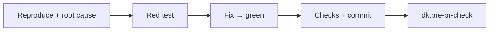
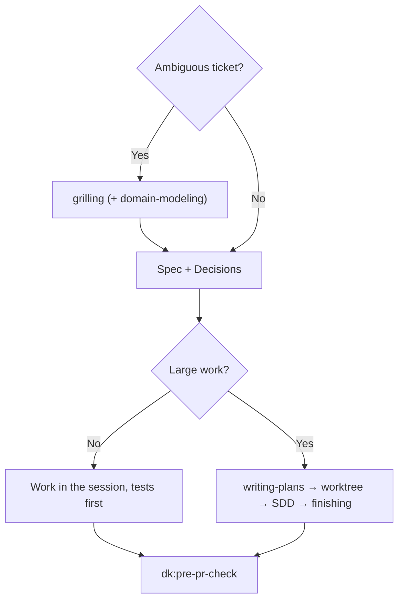

<!-- i18n: source=docs/en/03-skills.md source_commit=v1.4.6 review=human -->
[English](../en/03-skills.md) | Tiếng Việt | [简体中文](../zh-CN/03-skills.md) | [日本語](../ja/03-skills.md)

> Bản dịch này có thể chậm hơn bản tiếng Anh; bản tiếng Anh ([docs/en/03-skills.md](../en/03-skills.md)) là bản chuẩn.

# 3. Skills

Bốn controller dùng chung các khối hành vi sau, đứng trước các bước riêng của từng controller:

| Khối | Ý nghĩa |
|---|---|
| **Parts** | Chỉ đọc một part khi một bước nhắc đến; part không phải là skill |
| **Rules** | Áp dụng các rule đang bật trong `rules/RULES.md`: F1, F2, C1, C2, G1, S1, O1 ([04](04-rules.md)) |
| **Graph** | Nếu repo có index codegraph/CRG thì dùng theo rule G1; nếu không thì bỏ qua |
| **Commands** | Lấy lệnh kiểm tra và base branch từ `.dev-kit/config.yml` nếu có; nếu không thì dùng `make check` hoặc lệnh test của repo, và `main` |
| **Outputs** | Mọi thứ được ghi vào `.dev-kit/` (rule O1); kết thúc bằng một báo cáo theo `templates/report.md`; mức độ nghiêm trọng dùng thang blocker/major/minor (rule S1) |

Các ví dụ dưới đây là **minh họa, chưa chạy** trên repo của bạn. Ví dụ thật nằm trong lab, xem [06](06-evidence.md).

---

## 3.1 `dk:init`

**Dùng khi:** dùng dev-kit lần đầu trên một máy hoặc một repo; để kiểm tra lại phần thiết lập; hoặc để chạy lại một phần: `dk:init index` (ví dụ trong một worktree mới), `dk:init baseline`, `dk:init standards [rules|review]`.

**Nguyên tắc:**
- **Probe trước, rồi hỏi từng câu một, theo thứ tự cố định.** Mỗi câu hỏi cho thấy những gì agent tìm thấy, rồi các lựa chọn đánh chữ: `A` là câu trả lời được khuyến nghị, ghi "(Recommended)" và viết đầy đủ nội dung, `B`–`D` là các phương án thật, dòng cuối luôn là "Other" để bạn tự gõ câu trả lời (qua công cụ chọn của CLI nếu có, như `ask_question` của Antigravity, `ask_user` của Copilot hay `ask` của omp; Antigravity tự thêm dòng "Write-in..." để tự gõ). Nó chờ câu trả lời của bạn rồi mới sang câu tiếp theo. "default" và "skip" luôn dùng được. Nó không bao giờ hỏi điều mà code đã trả lời.
- Chạy lại chỉ kiểm tra và bổ sung phần còn thiếu; không ghi đè file đã có.
- Cài bất cứ thứ gì hoặc đổi bất cứ thứ gì ngoài repo đều phải hỏi trước.
- `.dev-kit/` là của riêng bạn: không thứ gì nó tạo ra bị commit, và nó không bao giờ sửa file đang được git theo dõi như `.gitignore`.
- Nó không chứa logic của controller.

**Các bước và câu hỏi, theo thứ tự:**
1. **Công cụ graph:** kiểm tra bằng `scripts/install-graph-tools.sh --check`. *Chỉ hỏi nếu thiếu một công cụ:* có cài không? Nếu bạn từ chối, nó tiếp tục với "G1 off". Nó không bao giờ chạy `codegraph install` hay `code-review-graph install` (hai lệnh đó đăng ký MCP, hook và các file hướng dẫn).
2. **Thiết lập cá nhân:** đọc `~/.dev-kit/config.yml` nếu một repo trước đó đã lưu ở đó thư mục tiêu chuẩn của team.
3. **Probe, không hỏi:** lệnh, base branch, stack, những gì linter đã ép buộc, các file đã được theo dõi trong `.dev-kit/`, `GLOSSARY.md` của chính dự án, `docs/adr/`, `CONSTRAINTS.md`.
4. *Câu hỏi:* **lệnh và base branch** (xác nhận hoặc sửa). Base branch được đối chiếu với nhánh mà các PR gần đây merge vào, không chỉ dựa vào `origin/HEAD`; nếu hai nhánh khác nhau thì được hỏi thành lựa chọn, kèm ngày commit và số commit chênh lệch. Sau đó nó tạo `.dev-kit/` cùng một `.gitignore` chứa `*` và ghi `config.yml`.
5. *Câu hỏi:* **index graph** (mặc định có; dung lượng dự kiến khoảng 0,16 MB và 0,6 MB cho mỗi file được index, đo được 136 MB và 529 MB với ~850 file). Các thư mục index vẫn hiện trong `git status` (codegraph giữ `.gitignore` riêng của nó ở trạng thái hiện) được đưa vào file exclude của repo (`git rev-parse --git-path info/exclude`, dùng chung cho mọi worktree); không bao giờ thêm `.dev-kit/` vào đó.
6. **Baseline:** chạy test và build một lần, lưu output vào `.dev-kit/baseline-test.log` và `.dev-kit/baseline-build.log` để không phải chạy lại bộ test. *Chỉ hỏi nếu đỏ:* **dừng** (sửa trước) hoặc **chấp nhận làm baseline đã biết**, ghi vào `.dev-kit/baseline.md`; từ đó một lần chạy chỉ thất bại khi có test **ngoài** danh sách đó lỗi (rule B1). Nếu test **không chạy được** (package restore, xác thực, thiếu một service), nó nói rõ và hỏi dừng hay tiếp tục với baseline được đánh dấu `not-measured` trong `config.yml`; chạy lại `dk:init baseline` khi môi trường đã hoạt động.
7. **Tiêu chuẩn theo hai lượt** (bên dưới).
8. *Câu hỏi:* **`CONSTRAINTS.md`** (tùy chọn, mặc định là không) → `.dev-kit/CONSTRAINTS.md`. Bỏ qua khi dự án đã có file riêng. Câu hỏi giải thích file này bổ sung gì cho repo của bạn (bên dưới).
9. **Báo cáo** `.dev-kit/init-report.md`, và kiểm tra `git status` không đổi.

**Tiêu chuẩn theo hai lượt** (thiết kế: [09](../en/09-init-and-standards.md), mục 9.6). Rule chỉ được viết cho những gì agent không thể biết hoặc đã bị thấy làm sai; không bao giờ về cách đặt tên hay style.
- **Probe trước:** linter và compiler bao phủ những gì; cấu trúc (các layer, cách truy cập dữ liệu, module, contract được expose, config, permission key), tìm bằng graph; các thư viện nội bộ (package nội bộ, bao nhiêu file dùng chúng so với các control của framework, các file gần đây dùng gì, danh sách component của chúng).
- **Mỗi câu hỏi một nhóm, như một buổi brainstorm:** danh sách của nhóm đó nêu chi tiết (từng mục: hỏi gì, vì sao, repo này vướng ở đâu, kèm các con số từ lệnh agent đã chạy; file kit được đánh dấu `validated` hoặc `experimental`), rồi một dòng **Recommended** với một lý do cho mỗi phần. "default" là nhận đúng dòng Recommended đang hiển thị, "skip" là không lấy gì, hoặc bạn trả lời từng mục. Mọi mục được giữ đều thuộc repo này; không có câu hỏi dự án hay team (hiện làm từng repo một). Một nhận định kiểu "X thay thế Y" mà không có bằng chứng sử dụng thì trở thành một lựa chọn để bạn quyết.
- **Lượt 1, rule khi viết code** (`## Design`/`## Implement`, được story-runner, bug-fixer, code-refactor dùng):
  1. **Architecture:** probe chính là danh sách tiêu chuẩn (kit không có file architecture, theo nguyên tắc 0); những gì code lân cận đã cho thấy thì không được khuyến nghị;
  2. mỗi file kit có mục Implement phù hợp với repo là một nhóm: `coding/review-basics`, `testing/basics`, `security/web`, `ui/forms-and-actions`;
  3. mỗi thư viện nội bộ là một nhóm (phiên bản cũ còn được phép không, control nào của framework vẫn được phép);
  4. **quy ước riêng của bạn, theo vòng lặp:** các đề xuất khác từ probe cộng với văn bản tự do, rồi hỏi tiếp sau mỗi câu trả lời cho đến khi bạn nói không. Câu hỏi được dựng theo ngữ cảnh, không bao giờ là câu trống "còn gì nữa không?": điều vừa thêm, các rule đã giữ đang phủ những phần nào, tối đa 3 vùng chưa có rule nào kèm bằng chứng (ví dụ xử lý ngày giờ, kèm thư viện và số file), và một câu hỏi gọi tên các vùng đó.

  Sau đó các rule của lượt 1 được đọc lại cho bạn xác nhận và được ghi.
- **Lượt 2, checklist review** (`## Review`/`## Do not flag`/`## Severity`, được pre-pr-check dùng): rule đã giữ ở lượt 1 không bị hỏi lại, mỗi rule được kiểm theo mức severity của nó, và `review/finding-quality` luôn bật.
  1. **Severity** của các rule đã giữ (mục kit giữ nguyên mức của nó; agent đề xuất một mức cho mỗi rule của repo);
  2. **các kiểm tra chỉ dành cho review** ("khi diff chạm X, hãy kiểm Y"), không bao giờ chỉ nhắc lại một rule của lượt 1;
  3. **Do not flag:** những gì linter, compiler và CI đã cưỡng chế, các dòng của kit, nhiễu của repo;
  4. **kiểm tra riêng của bạn, theo vòng lặp**, như ở lượt 1.

  Sau đó checklist được đọc lại và ghi vào chính các file topic đó.
- **Những gì bạn tự thêm bằng lời được xác nhận trước:** agent soạn lại đúng dạng sẽ ghi (trigger, áp dụng ở đâu, chỉ code mới hay cả code cũ, ngoại lệ, mức độ, phạm vi), đối chiếu với code (bao nhiêu chỗ đang theo và bao nhiêu chỗ chưa, chỗ xung đột, công cụ hay rule đã giữ có phủ chưa, reviewer có kiểm được hay không) rồi hỏi "Có đúng ý bạn không?": giữ như bản nháp, hẹp hơn, rộng hơn, hoặc bạn sửa lại.
- Không giới hạn số câu hỏi: các vòng lặp kết thúc khi bạn nói không. Chạy headless thì nhận từng dòng Recommended và kết thúc các vòng lặp. Làm lại một lượt bằng `dk:init standards rules` hoặc `dk:init standards review`.

**Tiêu chuẩn của kit** (tất cả là `experimental` cho đến khi đo trên các bug mới): `review/finding-quality` (luôn bật), `coding/review-basics`, `security/web` (OWASP Top 10:2025, ASVS 5.0), `testing/basics`, `ui/forms-and-actions` (WCAG 2.2).

**`CONSTRAINTS.md` so với tiêu chuẩn.** Cả hai đều là phần tùy chọn trong thiết lập của bạn, nhưng chúng trả lời những câu hỏi khác nhau:

| | Tiêu chuẩn (`.dev-kit/standards/`) | `CONSTRAINTS.md` |
|---|---|---|
| Trả lời | Code trong repo này được viết như thế nào? | Một thay đổi phải tốt đến mức nào trước khi được ship? |
| Nội dung | Các rule agent không thể đoán, theo topic, có ID (ví dụ "dùng control nội bộ") | Các con số kèm lệnh kiểm tra từng con số (ví dụ "không có lỗi type: `tsc --noEmit`", "các dòng thay đổi được cover ≥ 80%"), một mức sàn luôn áp dụng (không thêm `@ts-ignore`, stub, test bị skip, secret mới), các ngoại lệ đã thống nhất |
| Dùng khi | Lập kế hoạch, viết code và review | Bước 1 của `dk:pre-pr-check`: thay đổi vi phạm nó là blocker |
| Mục đích | Code khớp với repo | Agent không thể lặng lẽ hạ chuẩn để được xanh |

Khi không có `CONSTRAINTS.md`, `dk:pre-pr-check` vẫn đánh dấu các skip, suppression mới, assert bị xóa và ngưỡng bị nới lỏng trong diff. File này bổ sung các cổng bằng số cho những chiều mà repo chưa kiểm tra (coverage, lỗi type, quét bảo mật, ngân sách hiệu năng hoặc accessibility). Nó tốn thêm tối đa bốn câu hỏi (những chiều nào, chặn hay chỉ cảnh báo, con số mục tiêu hoặc "đo hôm nay rồi giữ nguyên", lệnh kiểm tra chậm nhất có thể chấp nhận) và có thể cần cài thêm một công cụ, luôn hỏi trước. Lợi ích của nó chưa được đo trong lab dev-kit, vì vậy mặc định là không. Phần phỏng vấn đến từ part `constraint-driven-development` (agent-skills).

**Đầu ra:** `config.yml`, thư mục `.dev-kit/`, các tiêu chuẩn bạn đã chọn, báo cáo init, và tùy chọn `.dev-kit/CONSTRAINTS.md` cùng các index graph. Không có gì để commit.

---

## 3.2 `dk:bug-fixer`

**Dùng khi:** một ticket bug, kể cả bug hiệu năng (thứ gì đó chậm đi sau một thay đổi).

**Các bước:**
1. **Tái hiện và tìm nguyên nhân gốc.** Với bug khó hoặc bug hiệu năng, đọc part `systematic-debugging` hoặc `diagnosing-bugs` và làm theo.
2. **Viết regression test** fail đúng lý do → sửa tại nguyên nhân gốc → test chuyển xanh.
3. **Chạy các lệnh kiểm tra.** Commit; message nêu nguyên nhân gốc.
4. **Chạy `dk:pre-pr-check`.**

**Đầu ra:** một commit sửa lỗi kèm test, một báo cáo, kết quả của pre-pr-check.

**Không có:** subagent tái hiện hay subagent sửa riêng (phiên bản cũ có, lab cho thấy chúng chỉ tốn thêm chi phí), và không dùng worktree.

**Ví dụ (minh họa):** ticket "Đơn hàng có 2 khuyến mãi bị tổng tiền hàng tụt về 0".
- Agent tìm thấy đoạn code cộng phần trăm của mọi khuyến mãi, trong khi quy tắc là chỉ lấy khuyến mãi cao nhất.
- Nó viết một test với hai khuyến mãi, 60% và 50% (đỏ), đổi code sang `max`, chạy các lệnh kiểm tra, và commit "fix: promotions must not stack".
- pre-pr-check: diff nhỏ nên nó tự self-review và viết báo cáo.

---

## 3.3 `dk:story-runner`

**Dùng khi:** một ticket feature/story.

**Các bước:**
1. **Làm rõ.** Nếu ticket mơ hồ, đọc part `grilling` và hỏi bạn từng câu một. Nếu có thuật ngữ nghiệp vụ mới, đọc thêm part `domain-modeling`. Chỉ khi không ai trả lời được (chạy headless) thì nó mới tự chọn một phương án hợp lý và đánh dấu là giả định.
2. **Viết spec** `.dev-kit/specs/<feature>.md` theo `templates/spec.md`: mục tiêu, quy tắc, interface, tiêu chí chấp nhận, ngoài phạm vi, và một mục **Decisions** (câu hỏi, câu trả lời, ai quyết định hoặc "assumption").
3. **Theo rule C1:**
   - **Việc nhỏ:** làm ngay trong session, test trước, mỗi hành vi một commit.
   - **Việc lớn** (hơn 3 task hoặc nhiều module): dùng các part theo thứ tự: `writing-plans` → `using-git-worktrees` → `subagent-driven-development` → `finishing-a-development-branch` (merge về branch bạn đang làm; không push/PR).
4. **Chạy `dk:pre-pr-check`.**

**Ví dụ (minh họa):** ticket "Khách hàng nhập mã giảm giá khi thanh toán".
- grilling hỏi: một hay nhiều mã cho mỗi đơn, trừ trước hay sau thuế, và hiển thị gì khi mã không hợp lệ.
- Spec ghi các câu trả lời vào Decisions.
- Đây là việc nhỏ (1 module) nên làm trong session: mỗi rule một test, mỗi hành vi một commit; cuối cùng chạy pre-pr-check.

---

## 3.4 `dk:code-refactor`

**Dùng khi:** một ticket nợ kỹ thuật: tách, gộp hoặc chuyển module **mà không đổi hành vi**.

**Các bước:**
1. **Chốt interface mới.** Nếu ranh giới chưa rõ, đọc part `codebase-design`.
2. **Viết characterization test trước**, tại interface công khai, cố định hành vi hiện tại cho mọi đầu vào. Cố định cả hành vi trông như bug: ghi vào báo cáo là "suspect bug" và **không sửa** trong lúc refactor.
3. **Theo rule C1:** với việc nhỏ, đi từng bước nhỏ trong session, kiểm tra sau mỗi bước, commit từng bước. Với việc lớn, dùng các part SDD như story-runner.
4. **Chạy `dk:pre-pr-check`.** Review kiểm tra "không đổi hành vi" và interface bạn đã chốt.

**Vì sao cố định cả hành vi trông như bug:** trong lab, một ticket refactor được chấm bằng cách so sánh hành vi trước và sau trên 300 đầu vào ngẫu nhiên. Nếu bạn "tiện tay sửa bug" trong lúc refactor, hành vi sẽ đổi, và reviewer không thể phân biệt đâu là refactor, đâu là sửa bug.

---

## 3.5 `dk:pre-pr-check`

**Dùng khi:** branch đã xong và sắp mở PR. Ba controller kia tự gọi nó ở cuối; bạn cũng có thể gọi trực tiếp cho một branch do người viết.

**Chế độ report-only:** nếu yêu cầu nói "do not change code", nó không sửa file nào và bỏ qua bước 4.

**Các bước:**
1. **Chạy các lệnh kiểm tra ngay lúc này** và giữ output làm Evidence. Đọc `git diff <base branch>...HEAD` để tìm dấu hiệu hạ tiêu chuẩn: test mới bị skip, thêm `noqa`/`ts-ignore`, xóa assert, hạ ngưỡng.
2. **Chọn mức review theo rule C2:**

   | Mức | Khi nào | Làm gì |
   |---|---|---|
   | Self-review | Diff ≤ 2 file và < 50 dòng (đo bằng `git diff --shortstat`) | Đọc part `code-review` và tự áp dụng hai trục của nó; không sinh subagent |
   | 1 reviewer | Mọi trường hợp còn lại | 1 subagent đa dụng đọc part `code-review` |
   | 4 reviewer | Bạn yêu cầu, hoặc diff đụng tới auth/quyền, secret, dữ liệu cá nhân, migration, config/env | Song song: 2 reviewer `code-review` (mỗi người một trục), `dk:security-auditor`, `dk:test-engineer` |

   Mỗi reviewer nhận phạm vi diff và nội dung spec/issue, và trả về `file:line | blocker/major/minor | lý do`.
3. **Gộp kết quả** vào một bảng theo thang blocker/major/minor. Nếu còn blocker nào mở thì `Verdict: NO-GO`; ngược lại là `GO`.
4. **Nếu có blocker:** đọc part `receiving-code-review`, sửa kèm bằng chứng (hoặc phản biện kèm lý do), rồi quay lại bước 1. Tối đa 2 vòng.
5. **Báo cáo kèm bảng finding.** Trừ khi ở chế độ report-only, ghi `.dev-kit/reports/pr-body.md` theo part `pr` (Summary / Evidence / Merge Danger), trong đó Evidence là output của bước 1.

**Ví dụ (minh họa):** một branch "hoàn tiền một phần" đụng tới quyền và dữ liệu cá nhân nên chạy 4 reviewer. Kết quả là NO-GO với các blocker sau:
- một role không phải nhân viên vẫn có thể hoàn tiền;
- một khoản hoàn tiền có thể bị lặp lại nhiều lần;
- làm tròn lên thay vì xuống;
- email của khách hàng bị lộ vào audit log.

Kèm theo là bảng file:line và nội dung PR đã soạn.

---

## 3.6 Hai persona agent

| Agent | Kiểm tra gì | Nguồn |
|---|---|---|
| `dk:security-auditor` | OWASP, secret, xác thực/phân quyền, dependency có CVE | agent-skills |
| `dk:test-engineer` | Độ phủ, edge case, đường lỗi; test có thật sự kiểm tra đúng rule hay không | agent-skills |

Chúng chỉ được sinh ra khi pre-pr-check chọn mức 4 reviewer. Một persona không gọi persona khác.
