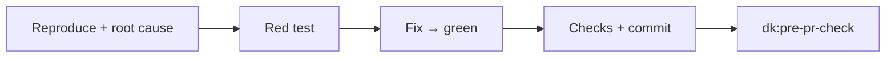
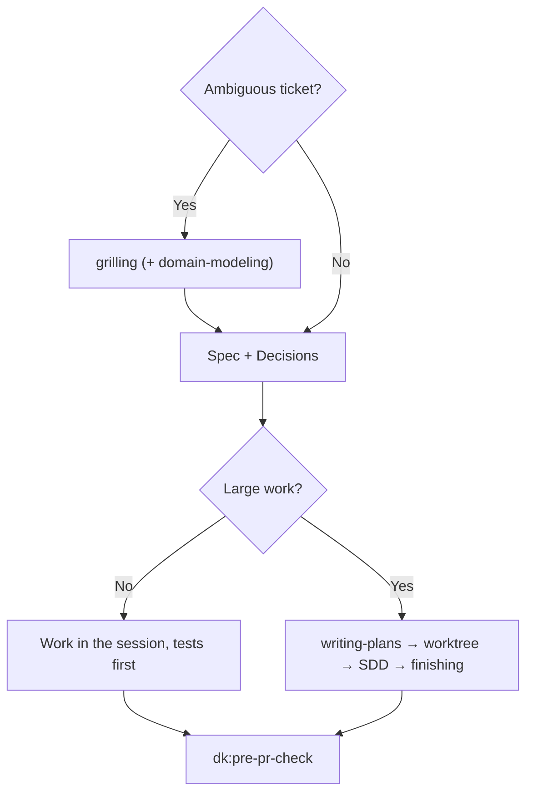

<!-- i18n: source=docs/en/03-skills.md source_commit=v1.0.0 review=human -->
[English](../en/03-skills.md) | Tiếng Việt | [简体中文](../zh-CN/03-skills.md) | [日本語](../ja/03-skills.md)

> Bản dịch này có thể chậm hơn bản tiếng Anh; bản tiếng Anh ([docs/en/03-skills.md](../en/03-skills.md)) là bản chuẩn.

# 3. Skills

Bốn controller dùng chung các khối hành vi sau, đứng trước các bước riêng của từng controller:

| Khối | Ý nghĩa |
|---|---|
| **Parts** | Chỉ đọc một part khi một bước nhắc đến; part không phải là skill |
| **Rules** | Áp dụng các rule đang bật trong `rules/RULES.md`: F1, F2, C1, C2, G1, S1, O1 ([04](04-rules.md)) |
| **Graph** | Nếu repo có index codegraph/CRG thì dùng theo rule G1; nếu không thì bỏ qua |
| **Commands** | Lấy lệnh kiểm tra và base branch từ `.dev-kit/config.yml` nếu có; nếu không thì dùng `make check` hoặc lệnh test của repo, và `main` |
| **Outputs** | Mọi thứ được ghi vào `.dev-kit/` (rule O1); kết thúc bằng một báo cáo theo `templates/report.md`; mức độ nghiêm trọng dùng thang blocker/major/minor (rule S1) |

Các ví dụ dưới đây là **minh họa, chưa chạy** trên repo của bạn. Ví dụ thật nằm trong lab, xem [06](06-evidence.md).

---

## 3.1 `dk:init`

**Dùng khi:** dùng dev-kit lần đầu trên một máy hoặc một repo; hoặc khi bạn muốn kiểm tra lại phần thiết lập.

**Nguyên tắc:**
- In kế hoạch trước, chờ bạn duyệt, rồi mới làm.
- Chạy lại chỉ kiểm tra và bổ sung phần còn thiếu; không ghi đè file đã có.
- Cài bất cứ thứ gì hoặc đổi bất cứ thứ gì ngoài repo đều phải hỏi trước.
- Nó không chứa logic của controller.

**Các bước:**
1. **Máy:** kiểm tra `git`, `gh`, `make`, `codegraph`, `code-review-graph` (kèm version); liệt kê các plugin đang bật và nhắc bạn gọi `dk:<controller>` theo tên.
   - **Kiểm tra các công cụ graph** bằng `scripts/install-graph-tools.sh --check`.
   - **Nếu thiếu:** nói rõ trong kế hoạch và hỏi một lần. Nếu bạn đồng ý, chạy `scripts/install-graph-tools.sh --install` (version được ghim; công cụ đã có thì để nguyên). Nếu bạn từ chối, tiếp tục và ghi "G1 off" trong báo cáo.
   - **Không bao giờ chạy** `codegraph install` hay `code-review-graph install`: hai lệnh đó đăng ký MCP, hook và các file hướng dẫn.
2. **Phát hiện lệnh:** từ `Makefile`, `package.json`, `pyproject.toml`. Nhờ bạn xác nhận, rồi ghi `.dev-kit/config.yml`.
3. **Tạo `.dev-kit/`** (specs, plans, reports). Hỏi phần nào sẽ được commit.
4. **Tùy chọn:** tạo `CONSTRAINTS.md` bằng part `constraint-driven-development` (hỏi bạn về tiêu chuẩn chất lượng; có ngưỡng mặc định).
5. **Index graph, mặc định bật** (nằm trong kế hoạch bạn duyệt):
   - chạy `codegraph init` và `code-review-graph build`;
   - với repo lớn, báo dung lượng đĩa trước và hỏi: khoảng 150 MB và 600 MB cho mỗi ~3,000 file;
   - thêm `.codegraph/` và `.code-review-graph/` vào `.gitignore`, và ghi `graph.*` trong `config.yml`.
6. **Baseline:** chạy test và build một lần.
   - **Xanh:** ghi vào báo cáo.
   - **Đỏ:** báo số lượng và các nhóm lỗi chính, rồi nhờ bạn chọn: **dừng** (sửa trước) hoặc **chấp nhận làm baseline đã biết**. Nếu chấp nhận, ghi `.dev-kit/baseline.md` (theo `templates/baseline.md`) liệt kê từng test đang lỗi theo tên. Từ đó controller chỉ coi một lần chạy là thất bại khi có test **ngoài** danh sách này lỗi (rule B1).
7. **Ghi `.dev-kit/init-report.md`.**

**Đầu ra:** `config.yml`, thư mục `.dev-kit/`, báo cáo init, và tùy chọn `CONSTRAINTS.md` cùng các index graph.

⚠️ `dk:init` **chưa từng được chạy trong lab**. Đây là thứ nên thử đầu tiên ([08](../en/08-roadmap.md)).

---

## 3.2 `dk:bug-fixer`

**Dùng khi:** một ticket bug, kể cả bug hiệu năng (thứ gì đó chậm đi sau một thay đổi).

**Các bước:**
1. **Tái hiện và tìm nguyên nhân gốc.** Với bug khó hoặc bug hiệu năng, đọc part `systematic-debugging` hoặc `diagnosing-bugs` và làm theo.
2. **Viết regression test** fail đúng lý do → sửa tại nguyên nhân gốc → test chuyển xanh.
3. **Chạy các lệnh kiểm tra.** Commit; message nêu nguyên nhân gốc.
4. **Chạy `dk:pre-pr-check`.**

**Đầu ra:** một commit sửa lỗi kèm test, một báo cáo, kết quả của pre-pr-check.

**Không có:** subagent tái hiện hay subagent sửa riêng (phiên bản cũ có, lab cho thấy chúng chỉ tốn thêm chi phí), và không dùng worktree.

**Ví dụ (minh họa):** ticket "Đơn hàng có 2 khuyến mãi bị tổng tiền hàng tụt về 0".
- Agent tìm thấy đoạn code cộng phần trăm của mọi khuyến mãi, trong khi quy tắc là chỉ lấy khuyến mãi cao nhất.
- Nó viết một test với hai khuyến mãi, 60% và 50% (đỏ), đổi code sang `max`, chạy các lệnh kiểm tra, và commit "fix: promotions must not stack".
- pre-pr-check: diff nhỏ nên nó tự self-review và viết báo cáo.

---

## 3.3 `dk:story-runner`

**Dùng khi:** một ticket feature/story.

**Các bước:**
1. **Làm rõ.** Nếu ticket mơ hồ, đọc part `grilling` và hỏi bạn từng câu một. Nếu có thuật ngữ nghiệp vụ mới, đọc thêm part `domain-modeling`. Chỉ khi không ai trả lời được (chạy headless) thì nó mới tự chọn một phương án hợp lý và đánh dấu là giả định.
2. **Viết spec** `.dev-kit/specs/<feature>.md` theo `templates/spec.md`: mục tiêu, quy tắc, interface, tiêu chí chấp nhận, ngoài phạm vi, và một mục **Decisions** (câu hỏi, câu trả lời, ai quyết định hoặc "assumption").
3. **Theo rule C1:**
   - **Việc nhỏ:** làm ngay trong session, test trước, mỗi hành vi một commit.
   - **Việc lớn** (hơn 3 task hoặc nhiều module): dùng các part theo thứ tự: `writing-plans` → `using-git-worktrees` → `subagent-driven-development` → `finishing-a-development-branch` (merge về branch bạn đang làm; không push/PR).
4. **Chạy `dk:pre-pr-check`.**

**Ví dụ (minh họa):** ticket "Khách hàng nhập mã giảm giá khi thanh toán".
- grilling hỏi: một hay nhiều mã cho mỗi đơn, trừ trước hay sau thuế, và hiển thị gì khi mã không hợp lệ.
- Spec ghi các câu trả lời vào Decisions.
- Đây là việc nhỏ (1 module) nên làm trong session: mỗi rule một test, mỗi hành vi một commit; cuối cùng chạy pre-pr-check.

---

## 3.4 `dk:code-refactor`

**Dùng khi:** một ticket nợ kỹ thuật: tách, gộp hoặc chuyển module **mà không đổi hành vi**.

**Các bước:**
1. **Chốt interface mới.** Nếu ranh giới chưa rõ, đọc part `codebase-design`.
2. **Viết characterization test trước**, tại interface công khai, cố định hành vi hiện tại cho mọi đầu vào. Cố định cả hành vi trông như bug: ghi vào báo cáo là "suspect bug" và **không sửa** trong lúc refactor.
3. **Theo rule C1:** với việc nhỏ, đi từng bước nhỏ trong session, kiểm tra sau mỗi bước, commit từng bước. Với việc lớn, dùng các part SDD như story-runner.
4. **Chạy `dk:pre-pr-check`.** Review kiểm tra "không đổi hành vi" và interface bạn đã chốt.

**Vì sao cố định cả hành vi trông như bug:** trong lab, một ticket refactor được chấm bằng cách so sánh hành vi trước và sau trên 300 đầu vào ngẫu nhiên. Nếu bạn "tiện tay sửa bug" trong lúc refactor, hành vi sẽ đổi, và reviewer không thể phân biệt đâu là refactor, đâu là sửa bug.

---

## 3.5 `dk:pre-pr-check`

**Dùng khi:** branch đã xong và sắp mở PR. Ba controller kia tự gọi nó ở cuối; bạn cũng có thể gọi trực tiếp cho một branch do người viết.

**Chế độ report-only:** nếu yêu cầu nói "do not change code", nó không sửa file nào và bỏ qua bước 4.

**Các bước:**
1. **Chạy các lệnh kiểm tra ngay lúc này** và giữ output làm Evidence. Đọc `git diff <base branch>...HEAD` để tìm dấu hiệu hạ tiêu chuẩn: test mới bị skip, thêm `noqa`/`ts-ignore`, xóa assert, hạ ngưỡng.
2. **Chọn mức review theo rule C2:**

   | Mức | Khi nào | Làm gì |
   |---|---|---|
   | Self-review | Diff ≤ 2 file và < 50 dòng (đo bằng `git diff --shortstat`) | Đọc part `code-review` và tự áp dụng hai trục của nó; không sinh subagent |
   | 1 reviewer | Mọi trường hợp còn lại | 1 subagent đa dụng đọc part `code-review` |
   | 4 reviewer | Bạn yêu cầu, hoặc diff đụng tới auth/quyền, secret, dữ liệu cá nhân, migration, config/env | Song song: 2 reviewer `code-review` (mỗi người một trục), `dk:security-auditor`, `dk:test-engineer` |

   Mỗi reviewer nhận phạm vi diff và nội dung spec/issue, và trả về `file:line | blocker/major/minor | lý do`.
3. **Gộp kết quả** vào một bảng theo thang blocker/major/minor. Nếu còn blocker nào mở thì `Verdict: NO-GO`; ngược lại là `GO`.
4. **Nếu có blocker:** đọc part `receiving-code-review`, sửa kèm bằng chứng (hoặc phản biện kèm lý do), rồi quay lại bước 1. Tối đa 2 vòng.
5. **Báo cáo kèm bảng finding.** Trừ khi ở chế độ report-only, ghi `.dev-kit/reports/pr-body.md` theo part `pr` (Summary / Evidence / Merge Danger), trong đó Evidence là output của bước 1.

**Ví dụ (minh họa):** một branch "hoàn tiền một phần" đụng tới quyền và dữ liệu cá nhân nên chạy 4 reviewer. Kết quả là NO-GO với các blocker sau:
- một role không phải nhân viên vẫn có thể hoàn tiền;
- một khoản hoàn tiền có thể bị lặp lại nhiều lần;
- làm tròn lên thay vì xuống;
- email của khách hàng bị lộ vào audit log.

Kèm theo là bảng file:line và nội dung PR đã soạn.

---

## 3.6 Hai persona agent

| Agent | Kiểm tra gì | Nguồn |
|---|---|---|
| `dk:security-auditor` | OWASP, secret, xác thực/phân quyền, dependency có CVE | agent-skills |
| `dk:test-engineer` | Độ phủ, edge case, đường lỗi; test có thật sự kiểm tra đúng rule hay không | agent-skills |

Chúng chỉ được sinh ra khi pre-pr-check chọn mức 4 reviewer. Một persona không gọi persona khác.
