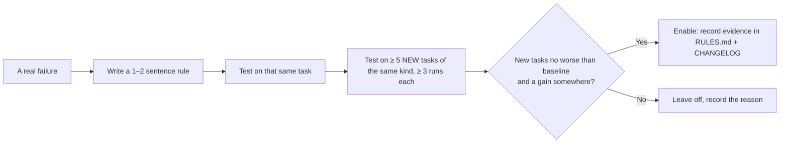

<!-- i18n: source=docs/en/04-rules.md source_commit=v1.7.2 review=human -->
[English](../en/04-rules.md) | Tiếng Việt

> Bản dịch này có thể chậm hơn bản tiếng Anh; bản tiếng Anh là bản chính thức. Xem [bản tiếng Anh](../en/04-rules.md).

# 4. Rules

File gốc: [`rules/RULES.md`](../../rules/RULES.md). Tài liệu này giải thích vì sao có từng rule.

## 4.1 Nguyên tắc

- **Một rule chỉ được bật khi có bằng chứng:** hoặc làm kết quả đúng hơn, hoặc rẻ hơn mà không kém đi, trên những bài nó **chưa từng thấy**.
- **Rule ngắn và rẻ:** một hai câu trong skill, không phải một quy trình nhiều bước.
- **Rule sai thì sửa và ghi lý do** vào `RULES.md` và `CHANGELOG.md`.

## 4.2 Các rule đang bật

### F1: Controller owns the flow

> When a part finishes, continue with the controller's next step; ignore part instructions to stop, hand off or wait for another command.

**Vì sao:** part copy từ bộ gốc được viết cho ngữ cảnh của bộ đó. Trong lab, một controller chỉ dùng skill của Matt Pocock đã gọi `diagnosing-bugs`. Part này chẩn đoán đúng nguyên nhân rồi **dừng lại** ("dừng trước bước sửa theo đúng yêu cầu"), nên ticket không được sửa. Từ khi có rule này, lab chưa gặp lại trường hợp dừng giữa chừng nào.

**Loại:** phòng lỗi quy trình; không làm tăng chất lượng.

### F2: Finish in this turn

> Run subagents in the foreground and wait for them in this turn; never use ScheduleWakeup, Monitor, cron or background waits. The final reply states what was done, the verdict and the report path.

**Vì sao:** trong 4/34 lần chạy lab (v0.4.1–0.6.0), agent đã hẹn giờ để chờ reviewer. Có một lần câu trả lời cuối là "đã dừng vòng lặp tự động" thay vì một kết luận, dù file báo cáo đã đầy đủ. Người dùng thật sẽ không bao giờ thấy verdict.

**Loại:** phòng lỗi quy trình.

### G1: Graph tools when indexed (optional)

> If `.codegraph/` exists: `codegraph sync`, then `explore`/`callers`/`impact` to locate code and `affected` to choose tests. If `.code-review-graph/` exists: `pre-pr-check` runs `update` + `detect-changes --brief` once and gives the summary to the reviewer. CLI only.

**Bằng chứng (17 lần chạy SWE Django, Haiku 5.5):**

| | Không index | Có index |
|---|---|---|
| Bài giải được | 10/17 | 10/17 |
| USD/lần chạy | 0.033 | 0.034 |
| Lệnh codegraph / CRG thật sự chạy | 0 / 0 | 27 / 33 |
| Lệnh grep | 58 | 31 |

**0.8.0 (playbook, 17 lần chạy có index):** 12/17 với 0.031 USD/lần chạy, so với 10/17 và 0.034 của 0.7. Không tốn thêm; +2 bài nằm trong dao động.

**Loại:** trung tính; không đo được lợi hay hại. Giữ ở dạng tùy chọn vì rẻ và chỉ chạy khi bạn đã dựng index. Nên đo lại trên repo lớn hơn hoặc lạ hơn, nơi tìm code là phần khó.

### C1: Default to the direct path

> Do the work in this session. Use subagent-driven development (SDD) only for large work (more than 3 tasks or several modules).

**Vì sao:** SDD spawn một implementer và một reviewer cho từng task, chiếm phần lớn chi phí. Với cùng kết quả test ẩn:
- S1 giảm từ 0.463 xuống 0.062 USD;
- S2 giảm từ 0.227 xuống 0.064 USD.

**Loại:** tiết kiệm chi phí mà không làm kết quả kém đi.

### C2: Review depth

> Small diff (≤ 2 files, < 50 lines): self-review. Otherwise: one reviewer. Four reviewers only when the user asks, or the diff touches auth/permissions, secrets, personal data, migrations or config/env. Computing prices is not a trigger.

**Vì sao:**
- **4 reviewer không bắt thêm lỗi:** ở 3 ticket pre-PR có lỗi cài sẵn, lần chạy không có controller đã bắt đủ 5/5 lỗi trên mỗi ticket.
- **Không tính code tính tiền là rủi ro:** bản 0.4.0 coi phần tính giá là rủi ro. Vì app mẫu là app giỏ hàng, gần như ticket nào cũng chạy 4 reviewer; chi phí tăng 3–4 lần mà không tăng chất lượng.
- **Vẫn giữ 4 reviewer cho diff rủi ro:** đây là biên an toàn; lợi ích của nó chưa được đo.

**Loại:** tiết kiệm chi phí và giữ biên an toàn cho diff rủi ro.

## 4.3 Chuẩn (luôn bật)

### S1: One severity scale

> `blocker` (must fix before merge), `major` (should fix before merge), `minor` (optional). Map other labels: Critical/High → blocker; Important/Medium → major; Minor/Low/Info/Nit → minor. Any open blocker → NO-GO.

**Vì sao:** các part copy từ bộ gốc dùng bốn thang khác nhau:
- reviewer của Superpowers: Critical/Important/Minor;
- `security-auditor`: Critical/High/Medium/Low/Info;
- `test-engineer`: thang ưu tiên riêng;
- controller: blocker/major/minor.

Gộp kết quả của chúng rất lẫn lộn. Từ 0.6.0, các prompt reviewer và agent persona đã được sửa để dùng chung một thang.

### O1: One personal output home

> dev-kit belongs to one developer and nothing it writes is committed. Everything goes under `.dev-kit/` (including the glossary, ADRs and `CONSTRAINTS.md` that parts produce), filled from `templates/`; `.dev-kit/.gitignore` (`*`) keeps the folder out of git. Never edit a tracked file for dev-kit's own bookkeeping: no `.gitignore`, `CLAUDE.md` or `AGENTS.md` changes; ignore local paths in `.git/info/exclude`. The project's own `GLOSSARY.md`, `docs/adr/` or `CONSTRAINTS.md` are read; changes to them are proposed, not made.

**Vì sao:** lần rà soát ngày 2026-10-13 tìm ra 3 chỗ lệch.
- Ledger SDD được ghi ra `.superpowers/sdd/`.
- `code-review` không tìm spec trong `.dev-kit/specs/`.
- `constraint-driven-development` tự sửa `CLAUDE.md`.

Trong 1.1.0, kit trở nên hoàn toàn của riêng một người dùng: trước đó `dk:init` thêm các thư mục index vào `.gitignore` và hỏi nên commit gì, `using-git-worktrees` commit một thay đổi `.gitignore`, còn `domain-modeling` / `constraint-driven-development` tạo file ở gốc repo. Tất cả những thứ đó sẽ đi vào repository của team.

### B1: Known-failure baseline

> If tests were already red at `dk:init` and you accepted them, `.dev-kit/baseline.md` lists them. A check passes when nothing fails outside the list. New failures are blockers. Never add to the list to make a change pass.

**Vì sao:** khi thử trên một repo thật (một Angular micro-frontend, khoảng 9,500 spec), nhánh gốc đã có sẵn 290–303 spec fail. Không có rule này thì `dk:init` dừng và không controller nào chạy được.

## 4.4 Các rule đang tắt (thử nghiệm)

### Q1: Sibling check

> A new field or parameter must be handled wherever its siblings are handled: `__repr__`, `__eq__`, `deconstruct`, sync/async twins, docs, tests.

**Vì sao tắt:**
- Ở bài SWE 16560, rule này nâng tỉ lệ giải từ 3/6 lên 6/6. Riêng một dòng rule trong prompt, không cần controller, cũng đạt 6/6.
- Nhưng rule được viết **sau khi** thấy chính bài đó trượt. Trên 5 bài mới cùng dạng, nó đạt 10/15, còn không có rule là 11/16: không giúp gì.
- Đây là một ca **overfitting** (quá khớp).

### Q2: Read ADRs first; the newest decision wins

**Vì sao tắt:** ở một ticket có ghi chú cũ mâu thuẫn với ADR, lần chạy không có rule đã tự chọn đúng ADR. Chưa đo được tác dụng nào.

## 4.5 Cách thêm hoặc bật một rule

Đo bằng lab của dev-kit (private):
- `scripts/run.sh` cho các ticket trên app mẫu;
- `scripts/run_swe.sh` cho các bài SWE-bench;
- biến thể `bsib` là mẫu cho cách thử "baseline + một dòng rule".
