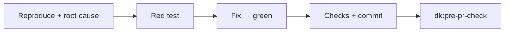
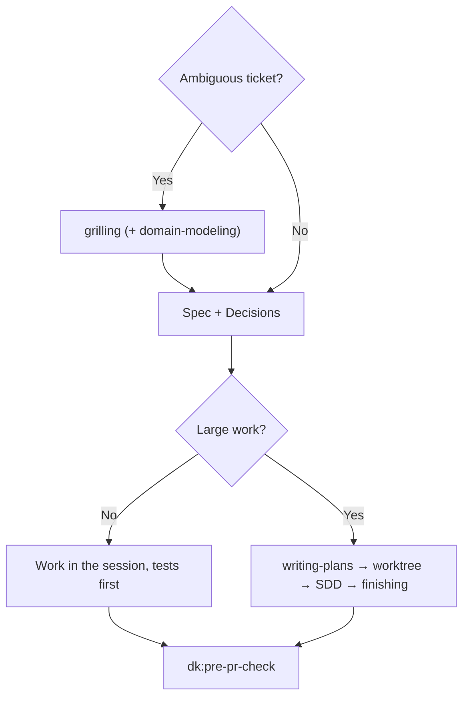

<!-- i18n: source=docs/en/03-skills.md source_commit=v1.2.4 review=machine -->
[English](../en/03-skills.md) | [Tiếng Việt](../vi/03-skills.md) | 简体中文 | [日本語](../ja/03-skills.md)

> 本译文可能滞后于英文版；以英文版为准：[03-skills.md](../en/03-skills.md)。

# 3. Skills

四个 controller 在各自的步骤之前，共享同样的行为块：

| 块 | 含义 |
|---|---|
| **Parts** | 只有当某个步骤提到某个 part 时才去读它；part 不是 skill |
| **Rules** | 应用 `rules/RULES.md` 中开启的 rule：F1、F2、C1、C2、G1、S1、O1（[04](../en/04-rules.md)，英文） |
| **Graph** | 如果仓库有 codegraph/CRG 索引，按 rule G1 使用；没有则跳过 |
| **Commands** | 如果存在 `.dev-kit/config.yml`，从中取检查命令和基础分支；否则使用 `make check` 或仓库的测试命令，以及 `main` |
| **Outputs** | 一切都写入 `.dev-kit/`（rule O1）；最后按 `templates/report.md` 出一份报告；严重程度使用 blocker/major/minor 分级（rule S1） |

下面的示例是**示意，并未运行**在你的仓库上。真实示例在 lab 中，见 [06](../en/06-evidence.md)（英文）。

---

## 3.1 `dk:init`

**使用场景：** 在一台机器或一个仓库上首次使用 dev-kit；重新检查设置；或重新运行其中一部分：`dk:init index`（例如在新的 worktree 中）、`dk:init baseline`、`dk:init standards [topic]`。

**原则：**
- **先探查，再按固定顺序一次问一个问题。** 每个问题都会显示 agent 发现了什么、一个默认值和简短的选项；等你回答后才问下一个。“default” 和 “skip” 始终可用。代码已经能回答的事，它不会问。
- 重新运行只会检查并补全缺失的部分；不会覆盖已有文件。
- 安装任何东西或修改仓库之外的任何内容，都要先询问。
- `.dev-kit/` 是个人的：它创建的任何内容都不会被提交，也从不修改 `.gitignore` 等被跟踪的文件。
- 它不包含任何 controller 逻辑。

**步骤与问题，按顺序：**
1. **Graph 工具：** 用 `scripts/install-graph-tools.sh --check` 检查。*仅在缺失时提问：* 是否安装？如果你拒绝，则继续，并写 “G1 off”。它绝不运行 `codegraph install` 或 `code-review-graph install`（这两个命令会注册 MCP、hook 和指令文件）。
2. **个人设置：** 如果之前某个仓库在 `~/.dev-kit/config.yml` 中保存了团队 standards 文件夹，就读取它。
3. **探查，不提问：** 命令、基础分支、技术栈、linter 已经强制执行的内容、`.dev-kit/` 下已被跟踪的文件、项目自己的 `GLOSSARY.md`、`docs/adr/`、`CONSTRAINTS.md`。
4. *提问：* **命令和基础分支**（确认或更正）。然后它创建 `.dev-kit/`，放入内容为 `*` 的 `.gitignore`，并写入 `config.yml`。
5. *提问：* **graph 索引**（默认是；大型仓库的预期占用，每约 3,000 个文件大致 150 MB 和 600 MB）。仍出现在 `git status` 中的索引文件夹（codegraph 会保留它自己的、可见的 `.gitignore`）会加入 `.git/info/exclude`。
6. **Baseline：** 运行一次测试和构建。*仅在红时提问：* **停止**（先修复）或**接受为已知 baseline**，写入 `.dev-kit/baseline.md`；此后只有在此列表**之外**的测试失败时，运行才算失败（rule B1）。如果测试**无法运行**（package restore、认证、缺少服务），它会说明这一点，并询问是停止，还是继续并在 `config.yml` 中将 baseline 标记为 `not-measured`；环境可用后重新运行 `dk:init baseline`。
7. **按 topic 的 standards**（见下）。
8. *提问：* **`CONSTRAINTS.md`**（可选，默认否）→ `.dev-kit/CONSTRAINTS.md`。如果项目自带，则跳过。该问题会说明这个文件能为你的仓库增加什么（见下文）。
9. **报告** `.dev-kit/init-report.md`，并检查 `git status` 没有变化。

**按 topic 的 standards**（设计：[09](../en/09-init-and-standards.md)，英文，9.6 节）。只为 agent 无法知道、或已被观察到会出错的内容写 rule；绝不涉及命名或风格。
- **先探查：** linter 覆盖了什么；in-house 库（内部包、使用它们的文件数与使用框架控件的文件数对比、最近的文件用什么、它们的组件列表）；中心服务和权限来源，用 graph 查找。
- **逐个 topic，按顺序：** `architecture`、`coding`、`testing`、`security`、`ui`、`api`、`data`、`ops`、`process`；没有可提供内容的 topic 会被跳过。每个 topic 一个问题（最多两个），合并以下内容：
  1. 该 topic 的 **kit 清单**（`standards/<topic>/`）：`validated` 文件预先勾选，`experimental` 文件不勾选；单个条目可以关闭。没有 kit 文件的 topic（目前是 `architecture`、`api`、`data`、`ops`、`process`）会说明原因：这些 topic 取决于具体仓库，所以按原则 0，它们的 rule 只来自建议部分；
  2. 根据探查结果给出的**带依据的项目或团队 rule 建议**（例如 “68 个文件使用 `<ui-…>`，4 个使用 `mat-input`：新代码应该使用 in-house 控件吗？”），每条都标明范围：项目或团队；对于 in-house 库，还会询问旧版本是否仍允许使用，以及哪些框架控件仍然允许使用；
  3. 选项 **“为该 topic 添加另一个约定”**。

  回答 “default” 只会启用 `validated` kit 文件，并且不保留任何建议的 rule；agent 可以推荐一个 `experimental` 文件或一条 rule，但需要你按名称勾选或保留。建议中的每个计数都来自 agent 运行过的命令；像 “X 取代 Y” 这样没有使用证据的说法，会作为问题来问。
- 最多 12 个 standards 问题，然后是**一个开放问题**：“agent 还应该知道其他约定吗？”
- agent 按标准格式起草 rule，**读给你确认**，然后把项目 rule 写入 `.dev-kit/standards/<topic>/`，把团队 rule 写入团队文件夹（只问一次，记在 `~/.dev-kit/config.yml` 中）。

**Kit standards**（在新 bug 上测量之前全部是 `experimental`）：`review/finding-quality`（始终开启）、`coding/review-basics`、`security/web`（OWASP Top 10:2025、ASVS 5.0）、`testing/basics`、`ui/forms-and-actions`（WCAG 2.2）。

**`CONSTRAINTS.md` 与 standards 的区别。** 两者都是 setup 中的可选部分，但回答的是不同的问题：

| | Standards（`.dev-kit/standards/`） | `CONSTRAINTS.md` |
|---|---|---|
| 回答 | 这个仓库里的代码怎么写？ | 一个变更要达到多好才能发布？ |
| 内容 | agent 猜不到的 rule，按 topic 分组，带 ID（例如 “使用 in-house 控件”） | 数字，以及检查每个数字的命令（例如 “零类型错误：`tsc --noEmit`”、“变更行覆盖率 ≥ 80%”），始终适用的底线（不新增 `@ts-ignore`、stub、被跳过的测试、secret），以及商定的例外 |
| 使用时机 | 规划、编码和 review | `dk:pre-pr-check` 第 1 步：违反它的变更是 blocker |
| 目的 | 让代码契合仓库 | agent 不能悄悄降低标准来让检查变绿 |

没有 `CONSTRAINTS.md` 时，`dk:pre-pr-check` 仍会标出 diff 中新增的跳过、抑制、被删除的 assert 和被削弱的阈值。该文件为仓库尚未检查的维度增加数字门槛（覆盖率、类型错误、安全扫描、性能或无障碍预算）。它最多多花四个问题（哪些维度、阻止还是警告、目标数字或 “今天测量并保持”、可接受的最慢检查），并且可能需要安装工具，这一点始终会先询问。它的收益尚未在 dev-kit lab 中测量，所以默认是否。该访谈来自 `constraint-driven-development` part（agent-skills）。

**输出：** `config.yml`、`.dev-kit/` 目录、你选择的 standards、init 报告，以及可选的 `.dev-kit/CONSTRAINTS.md` 和 graph 索引。无需提交任何内容。

---

## 3.2 `dk:bug-fixer`

**使用场景：** bug 工单，包括性能 bug（某次改动之后变慢了）。

**步骤：**
1. **复现并找到根因。** 对于难的 bug 或性能 bug，读取 `systematic-debugging` 或 `diagnosing-bugs` part 并照做。
2. **写一个回归测试**，使其因正确的原因而失败 → 在根因处修复 → 测试变绿。
3. **运行检查命令。** 提交；commit message 要写明根因。
4. **运行 `dk:pre-pr-check`。**

**输出：** 一个带测试的修复 commit、一份报告、pre-pr-check 的结果。

**不包含：** 单独的复现 subagent 或修复 subagent（旧版本有，lab 表明它们只会增加成本），也不使用 worktree。

**示例（示意）：** 工单“一个含 2 个促销的订单，其商品总额降为 0”。
- agent 发现有代码把所有促销的百分比相加，而规则是只取最高的那个促销。
- 它写了一个含两个促销（60% 和 50%）的测试（红），把代码改为 `max`，运行检查，并提交 “fix: promotions must not stack”。
- pre-pr-check：diff 很小，所以做 self-review 并写出报告。

---

## 3.3 `dk:story-runner`

**使用场景：** 功能/story 工单。

**步骤：**
1. **澄清。** 如果工单含糊不清，读取 `grilling` part，一次问你一个问题。如果有新的业务术语，也读取 `domain-modeling` part。只有在没有人能回答时（headless 运行），它才自己选一个合理的方案，并标记为 assumption。
2. **写 spec** `.dev-kit/specs/<feature>.md`，按 `templates/spec.md`：目标、rule、接口、验收标准、范围之外，以及一个 **Decisions** 部分（问题、答案、谁决定，或 “assumption”）。
3. **遵循 rule C1：**
   - **小型工作：** 直接在 session 中完成，测试先行，每个行为一个 commit。
   - **大型工作**（超过 3 个任务或涉及多个模块）：按顺序使用这些 part：`writing-plans` → `using-git-worktrees` → `subagent-driven-development` → `finishing-a-development-branch`（合并回你正在工作的分支；不 push/不开 PR）。
4. **运行 `dk:pre-pr-check`。**

**示例（示意）：** 工单“顾客在结账时输入折扣码”。
- grilling 会问：每个订单是一个码还是多个码，在税前还是税后扣除，以及无效的码显示什么。
- spec 把答案记录在 Decisions 中。
- 这是小型工作（1 个模块），所以在 session 中完成：每条 rule 一个测试，每个行为一个 commit；最后运行 pre-pr-check。

---

## 3.4 `dk:code-refactor`

**使用场景：** 技术债工单：拆分、合并或移动模块，且**不改变行为**。

**步骤：**
1. **确定新的接口。** 如果边界不清楚，读取 `codebase-design` part。
2. **先写 characterization test**，在公共接口上，针对每种输入固定当前行为。看起来像 bug 的行为也要固定：在报告中记为 “suspect bug”，并且在重构期间**不要修复**它。
3. **遵循 rule C1：** 小型工作在 session 内小步移动，每步之后检查，每步提交。大型工作则像 story-runner 那样使用 SDD 的 part。
4. **运行 `dk:pre-pr-check`。** review 会检查“没有行为变化”以及你确定的接口。

**为什么连看起来像 bug 的行为也要固定：** 在 lab 中，一张重构工单是通过在 300 个随机输入上比较前后行为来评分的。如果你在重构期间“顺手修个 bug”，行为就变了，reviewer 无法分辨哪部分是重构，哪部分是 bug 修复。

---

## 3.5 `dk:pre-pr-check`

**使用场景：** 分支完成，即将开 PR。其他三个 controller 会在结束时自动调用它；你也可以直接对一个由人写的分支调用它。

**Report-only 模式：** 如果请求里说“不要修改代码”，它不会编辑任何文件，并跳过第 4 步。

**步骤：**
1. **立即运行检查命令**，并把输出保留为 Evidence。阅读 `git diff <base branch>...HEAD`，查找降低标准的迹象：新增被跳过的测试、添加了 `noqa`/`ts-ignore`、删除了 assert、降低了阈值。
2. **按 rule C2 选择 review 级别：**

   | 级别 | 何时 | 做什么 |
   |---|---|---|
   | Self-review | Diff ≤ 2 个文件且 < 50 行（用 `git diff --shortstat` 测量） | 读取 `code-review` part，自己应用它的两个轴；不启动 subagent |
   | 1 个 reviewer | 其他所有情况 | 1 个读取 `code-review` part 的通用 subagent |
   | 4 个 reviewer | 你要求，或 diff 涉及 auth/权限、secret、个人数据、migration、config/env | 并行：2 个 `code-review` reviewer（各负责一个轴）、`dk:security-auditor`、`dk:test-engineer` |

   每个 reviewer 都会收到 diff 范围和 spec/issue 文本，并返回 `file:line | blocker/major/minor | reason`。
3. **把结果合并**成一张按 blocker/major/minor 分级的表。只要还有任何 blocker 未解决，就是 `Verdict: NO-GO`；否则是 `GO`。
4. **如果有 blocker：** 读取 `receiving-code-review` part，用证据修复（或附理由反驳），然后回到第 1 步。最多 2 轮。
5. **附带 findings 表出报告。** 除非是 report-only 模式，否则按 `pr` part 写入 `.dev-kit/reports/pr-body.md`（Summary / Evidence / Merge Danger），其中 Evidence 是第 1 步的输出。

**示例（示意）：** 一个“部分退款”分支涉及权限和个人数据，所以运行 4 个 reviewer。结果是 NO-GO，blocker 如下：
- 非员工角色仍然可以发起退款；
- 退款可以被重复多次；
- 舍入方向是向上而不是向下；
- 客户的 email 泄露到了 audit log 中。

同时附带一张 file:line 表和一份起草好的 PR 正文。

---

## 3.6 两个 persona agent

| Agent | 检查什么 | 来源 |
|---|---|---|
| `dk:security-auditor` | OWASP、secret、认证/授权、带 CVE 的依赖 | agent-skills |
| `dk:test-engineer` | 覆盖率、边界情况、错误路径；测试是否真正检查了正确的 rule | agent-skills |

只有当 pre-pr-check 选择 4 个 reviewer 的级别时，才会启动它们。一个 persona 不会调用另一个 persona。
